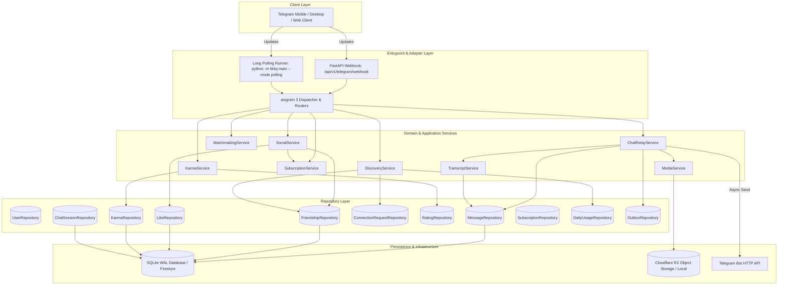
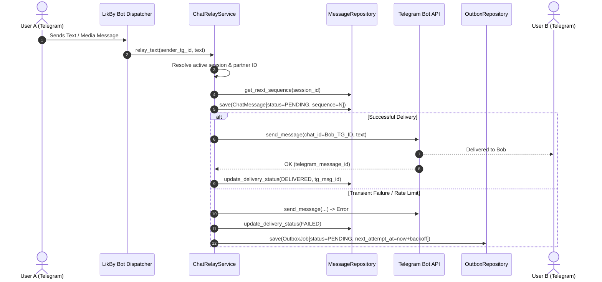
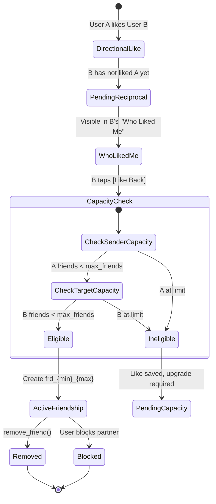

# LikBy 💙 — Meet. Connect. Play.

[](https://www.python.org/)
[](https://fastapi.tiangolo.com/)
[](https://docs.aiogram.dev/)
[](https://sqlite.org/)
[](https://developers.cloudflare.com/r2/)
[]()
[](LICENSE)

> **LikBy** is a production-grade session-based Telegram social discovery, real-time anonymous matching, and social connection platform.
> Live Telegram Bot: [@LikBy_bot](https://t.me/LikBy_bot)

---

## 📑 Table of Contents

- [1. Product Overview](#1-product-overview)
- [2. System Architecture](#2-system-architecture)
- [3. Core System Flows](#3-core-system-flows)
  - [3.1 Message Ingestion & Delivery Pipeline](#31-message-ingestion--delivery-pipeline)
  - [3.2 Standardized Human-Readable Chat Transcript](#32-standardized-human-readable-chat-transcript)
  - [3.3 Mutual Likes & Canonical Friendship Lifecycle](#33-mutual-likes--canonical-friendship-lifecycle)
  - [3.4 Discovery, Search Quotas & Connection Requests](#34-discovery-search-quotas--connection-requests)
  - [3.5 Reputation, Ratings & Auditable Karma Ledger](#35-reputation-ratings--auditable-karma-ledger)
  - [3.6 Centralized Subscription & Entitlement Engine](#36-centralized-subscription--entitlement-engine)
- [4. Technology Stack & Component Boundaries](#4-technology-stack--component-boundaries)
- [5. Database Schema & Storage Design](#5-database-schema--storage-design)
- [6. Configuration & Environment Variables](#6-configuration--environment-variables)
- [7. Local Development Quickstart](#7-local-development-quickstart)
- [8. Testing & QA Automation](#8-testing--qa-automation)
- [9. Production Deployment Guide (Render & Cloudflare)](#9-production-deployment-guide-render--cloudflare)
- [10. Architecture Documentation Index](#10-architecture-documentation-index)

---

## 1. Product Overview

LikBy provides a safe, welcoming, and privacy-respecting environment where adults can discover interesting people, chat anonymously in real time, build friendships, and play casual games.

### Key Value Propositions
* 🔒 **Zero Contact Leakage:** Phone numbers, Telegram handles, and locations are strictly protected. Users choose a permanent unique ID (e.g. `@cryptowizard` or `LK-10001`) and a customizable display name.
* 💬 **Durable Session Chat Engine:** Real-time message and media forwarding with strict per-session ordering, outbox pattern failure recovery, and on-demand `.txt` transcript exports.
* 💙 **Mutual-Like Friendships:** Express interest after a chat session. If both users like each other, an atomic canonical friendship is established.
* 🌟 **Transparent Karma System:** Post-session ratings (+1 Like / -1 Dislike) feed into an immutable, auditable karma ledger with net-contribution reversal protection.
* 🛡️ **Responsible Moderation:** Bilateral blocking and evidence logging without unverified automated karma penalties.
* 🕹️ **Casual Solo Arcade & Multiplayer:** Trivia Blitz, Gem Hunter (Mini-Mines), Rock-Paper-Scissors while in matching queues, and in-chat Tic-Tac-Toe.

---

## 2. System Architecture

LikBy follows a **modular monolith architecture** with explicit boundaries between Telegram interaction adapters, application domain services, repository persistence layers, and external storage engines.



---

## 3. Core System Flows

### 3.1 Message Ingestion & Delivery Pipeline

Every message relayed through an active chat session follows an outbox-backed delivery lifecycle:



---

### 3.2 Standardized Human-Readable Chat Transcript

LikBy does not require users or support staff to parse raw JSON message objects. The `TranscriptService` and `TranscriptFormatter` generate standardized plain text `.txt` documents on demand:

```text
LIKBY CHAT SESSION
Session ID: cs_01K8XYZ...
Started: 2026-10-16 12:30:00 UTC

Participants:
User A (ID: LK-10001)
User B (ID: LK-10002)

[12:30:01] User A (LK-10001): Hi!
[12:30:05] User B (LK-10002): Hello!
[12:30:12] User A (LK-10001): How was your day?
[12:30:20] User B (LK-10002): It was great!
[12:30:25] User A (LK-10001): [PHOTO: ast_01K8DEF_photo.jpg]
[12:31:00] SYSTEM: Session reported.
[12:31:05] SYSTEM: Report submitted for review.

Session Status: ENDED
```

---

### 3.3 Mutual Likes & Canonical Friendship Lifecycle

Directional likes and friendships are separate entities. Friendships use canonical pairs `frd_{min(u1, u2)}_{max(u1, u2)}` to eliminate duplicates:



---

### 3.4 Discovery, Search Quotas & Connection Requests

1. **Format Validation:** Query can be a permanent handle (`@username`) or internal user ID.
2. **Quota Check:** Server verifies daily quota against `SubscriptionEntitlement` and atomic counter `DailyUsage`. Free tier permits 3 searches/day.
3. **Privacy Filter:** Only public display ID and coarse activity state (`Active recently`, `Inactive`, `Hidden`) are returned.
4. **Connection Invitation:** Requester can send a `ConnectionRequest`. When accepted, both users' friend limits are verified before atomically establishing friendship.

---

### 3.5 Reputation, Ratings & Auditable Karma Ledger

* **Good Chat (Like):** `+1` karma.
* **Poor Chat (Dislike):** `-1` karma.
* **Rating Reversal:** If User A changes their rating from Like to Dislike, the system applies `new_delta - old_delta = (-1) - (+1) = -2` net delta.
* **Audit Trail:** Every point adjustment creates an immutable `KarmaLedgerEntry` with a unique idempotency key preventing double execution.
* **Non-Punitive Reporting:** Filing an abuse report immediately applies a bilateral block and notifies moderators, but **does not deduct karma** until verified by a human moderator.

---

### 3.6 Centralized Subscription & Entitlement Engine

| Feature | Free Tier | Premium Tier | Higher Tier |
| :--- | :---: | :---: | :---: |
| **Max Concurrent Friends** | **3** | **10** | **25** |
| **Daily ID Searches** | **3** / day | **20** / day | **100** / day |
| **Daily Connection Requests** | **5** / day | **25** / day | **100** / day |
| **View Incoming Likes** | Included 💙 | Included 💙 | Included 💙 |
| **Casual Solo Arcade Games** | Included 🕹️ | Included 🕹️ | Included 🕹️ |

> **Downgrade Safety:** Expired subscriptions automatically revert feature quotas to the Free tier, but **never delete existing friendships**.

---

## 4. Technology Stack & Component Boundaries

| Layer | Technology | Rationale |
| :--- | :--- | :--- |
| **Runtime & Language** | Python 3.11+ / 3.13 | High performance, modern async/await syntax, strong typing |
| **Web Server** | FastAPI & Uvicorn | Production ASGI server for webhooks and health endpoints |
| **Telegram Framework** | aiogram 3.15+ | Modern async Telegram Bot API framework with clean routing & FSM |
| **Database** | SQLite WAL / aiosqlite | High-concurrency local database with zero-maintenance WAL mode |
| **Cloud Storage** | Cloudflare R2 (S3-compatible) | Zero egress fee object storage for encrypted media archival |
| **Data Validation** | Pydantic v2 | Strict schema validation and immutable domain entity modeling |
| **Test Automation** | pytest & pytest-asyncio | 53 unit, integration, and API tests with 100% pass rate |

---

## 5. Database Schema & Storage Design

The database schema (`src/likby/repositories/sqlite/database.py`) enforces referential integrity:

1. `users` — Account standing, karma score, verification state, immutable handle.
2. `profiles` — Non-unique display names, age, gender, interests.
3. `chat_sessions` — Active and archived chat pairings with metadata.
4. `messages` — Durable chat messages with strict per-session ordering sequence.
5. `media_assets` — S3/R2 storage references, SHA-256 integrity hashes, MIME types.
6. `likes` — Directional social interest records with unique `(sender_id, target_id)`.
7. `friendships` — Canonical mutual relationships with key `frd_{min}_{max}`.
8. `connection_requests` — Discovery connection invitations and lifecycle state.
9. `session_ratings` — Post-session like/dislike evaluations per session participant.
10. `karma_ledger` — Immutable audit ledger of all reputation score adjustments.
11. `subscriptions` — Evaluated tier standing and quota parameters.
12. `daily_usage` — Daily search and connection request consumption counters.
13. `outbox_jobs` — Transactional message delivery queue with retry timestamps.
14. `reports` & `user_blocks` — Abuse reports and bilateral safety blocklists.

---

## 6. Configuration & Environment Variables

Copy `.env.example` to `.env` and fill in your credentials:

```bash
cp .env.example .env
```

| Variable | Description | Example Value |
| :--- | :--- | :--- |
| `BOT_TOKEN` | Telegram Bot Token from `@BotFather` | `8301943432:AAFtX...` |
| `BOT_MODE` | Bot execution mode (`polling` or `webhook`) | `polling` |
| `BASE_URL` | Public HTTPS URL for webhook callbacks | `https://likby.onrender.com` |
| `WEBHOOK_SECRET_TOKEN` | Secret header string for Telegram webhook validation | `your_secret_32_hex` |
| `DATABASE_URL` | SQLite or external database connection URL | `sqlite+aiosqlite:///likby.db` |
| `STORAGE_PROVIDER` | Media storage provider (`local` or `r2`) | `local` |
| `R2_ACCOUNT_ID` | Cloudflare Account ID for R2 storage | `your_account_id` |
| `R2_ACCESS_KEY_ID` | Cloudflare R2 S3 Access Key | `your_access_key` |
| `R2_SECRET_ACCESS_KEY` | Cloudflare R2 S3 Secret Key | `your_secret_key` |
| `R2_BUCKET_NAME` | Cloudflare R2 bucket name | `likby-media` |

---

## 7. Local Development Quickstart

### Prerequisites
* Python 3.11 or newer (Python 3.12 / 3.13 supported)
* Git

### Step-by-Step Setup

```bash
# 1. Clone repository
git clone https://github.com/likby-dev/LikBy.git
cd LikBy

# 2. Create virtual environment
python -m venv .venv
source .venv/bin/activate  # On Windows: .venv\Scripts\activate

# 3. Install dependencies in editable mode
pip install -e .

# 4. Configure environment
cp .env.example .env
# Edit .env with your BOT_TOKEN and settings

# 5. Launch bot in local polling mode
python -m likby.main --mode polling
```

---

## 8. Testing & QA Automation

LikBy maintains automated tests covering unit domain logic, repository persistence, API endpoints, and end-to-end service workflows:

```bash
# Run all tests
python -m pytest -v

# Run with coverage report
python -m pytest --cov=likby --cov-report=term-missing
```

### Verified Test Results
```text
============================= 53 passed in 18.56s =============================
tests/integration/test_api.py::test_health_live PASSED
tests/integration/test_api.py::test_webhook_rejects_missing_or_invalid_secret_token PASSED
tests/integration/test_new_repositories.py::test_message_and_outbox_repositories PASSED
tests/integration/test_new_repositories.py::test_social_and_subscription_repositories PASSED
tests/integration/test_sqlite_repositories.py::test_user_repository_crud PASSED
tests/integration/test_sqlite_repositories.py::test_report_repository PASSED
tests/unit/test_transcript.py::test_transcript_formatting_specification PASSED
tests/unit/test_media_archival.py::test_media_archival_and_hash_calculation PASSED
tests/unit/test_karma_service.py::test_session_rating_and_karma_lifecycle PASSED
tests/unit/test_social_service.py::test_mutual_like_friendship_and_capacity_limits PASSED
tests/unit/test_discovery_and_subscriptions.py::test_id_search_daily_quota_and_upgrade PASSED
... (53 total test cases passed)
```

---

## 9. Production Deployment Guide (Render & Cloudflare)

### Deploying on Render

1. Create a **New Web Service** connected to `https://github.com/likby-dev/LikBy`.
2. Select Environment: **Python 3**.
3. Build Command: `pip install -e .`
4. Start Command: `uvicorn likby.main:app --host 0.0.0.0 --port 10000`
5. Configure Environment Variables in Render Dashboard:
   * `BOT_TOKEN`: Your Telegram Bot API token.
   * `BOT_MODE`: `webhook`
   * `BASE_URL`: `https://your-service.onrender.com`
   * `WEBHOOK_SECRET_TOKEN`: A secure random token.
   * `STORAGE_PROVIDER`: `r2`
   * `R2_ACCOUNT_ID`, `R2_ACCESS_KEY_ID`, `R2_SECRET_ACCESS_KEY`, `R2_BUCKET_NAME`.
6. Health Check Path: `/health/ready`

---

## 10. Architecture Documentation Index

For in-depth design specifications and runbooks, consult the `/docs` directory:

| Document | Description |
| :--- | :--- |
| [`05-high-level-architecture.md`](docs/05-high-level-architecture.md) | Layered architecture and subsystem decomposition |
| [`07-domain-model.md`](docs/07-domain-model.md) | Business logic and domain invariants |
| [`11-telegram-bot-design.md`](docs/11-telegram-bot-design.md) | Bot menus, callbacks, and UX flows |
| [`14-matching-engine.md`](docs/14-matching-engine.md) | Compatibility scoring and queue dispatching |
| [`15-chat-session-lifecycle.md`](docs/15-chat-session-lifecycle.md) | Session creation, message relay, and termination |
| [`18-security-threat-model.md`](docs/18-security-threat-model.md) | Threat modeling and authorization controls |
| [`20-storage-and-persistence.md`](docs/20-storage-and-persistence.md) | SQLite schema, indexing, and WAL mode |
| [`28-render-deployment.md`](docs/28-render-deployment.md) | Render hosting specifications and webhooks |
| [`39-architecture-decisions.md`](docs/39-architecture-decisions.md) | Architecture Decision Records (ADRs) |

---

## 📄 License

This project is licensed under the MIT License — see the [LICENSE](LICENSE) file for details.
