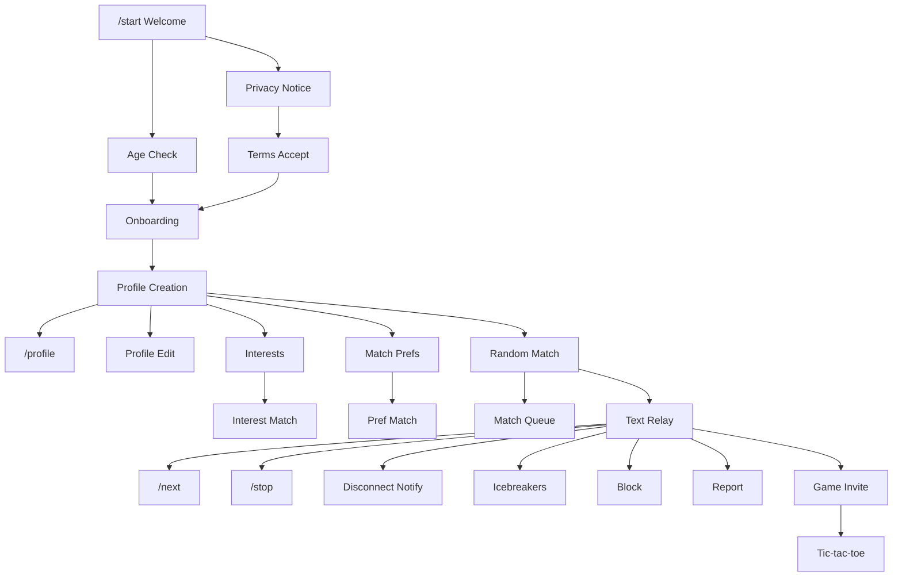

# 01 — Product Requirements

## Purpose

Define the complete feature inventory for Tikible, classify each feature by implementation phase, and establish dependencies between features.

## Scope

This document covers all planned features across the Telegram bot, future web app, and future Telegram Mini App. Only Telegram bot features are in scope for the current implementation phase.

---

## Feature Inventory

### Legend

| Phase | Meaning |
|---|---|
| **MVP** | Required for initial Telegram bot launch |
| **Post-MVP** | Planned after core stability is proven |
| **Future** | Research or design only; no implementation commitment |

---

### 1. Onboarding & Identity

| # | Feature | Phase | Dependencies | Description |
|---|---|---|---|---|
| F-001 | `/start` welcome | MVP | None | Bot introduction, privacy notice, eligibility prompt |
| F-002 | Age eligibility check | MVP | F-001 | Self-declared age gate (18+). Not verified identity |
| F-003 | Privacy notice | MVP | F-001 | Clear disclosure of data handling and Telegram's role |
| F-004 | Terms acceptance | MVP | F-001, F-003 | User must acknowledge terms before proceeding |
| F-005 | Onboarding flow | MVP | F-001–F-004 | Guided profile creation after eligibility |

### 2. Profile & Preferences

| # | Feature | Phase | Dependencies | Description |
|---|---|---|---|---|
| F-010 | Profile creation | MVP | F-005 | Display name, optional gender, bio |
| F-011 | `/profile` view | MVP | F-010 | View current profile information |
| F-012 | Profile editing | MVP | F-010 | Update display name, bio, interests |
| F-013 | Interest selection | MVP | F-010 | Choose from predefined interest tags |
| F-014 | Matching preferences | MVP | F-010 | Preferred gender, age range for matches |
| F-015 | Language preferences | Post-MVP | F-010 | Preferred conversation languages |
| F-016 | `/settings` | MVP | F-010 | View and update preferences |

### 3. Matching

| # | Feature | Phase | Dependencies | Description |
|---|---|---|---|---|
| F-020 | Random matching | MVP | F-010 | Join queue for random anonymous match |
| F-021 | Interest-based matching | MVP | F-013, F-020 | Prefer candidates with shared interests |
| F-022 | Preference-compatible matching | MVP | F-014, F-020 | Filter by gender/age preferences |
| F-023 | Match queue & waiting | MVP | F-020 | Queue entry, waiting notifications, timeout |
| F-024 | Language-based matching | Post-MVP | F-015, F-020 | Prefer same-language candidates |
| F-025 | AI-enhanced matching | Future | F-020, AI provider | Semantic interest similarity scoring |

### 4. Chat Session

| # | Feature | Phase | Dependencies | Description |
|---|---|---|---|---|
| F-030 | Anonymous text relay | MVP | F-020 | Relay text messages between matched users |
| F-031 | `/next` | MVP | F-030 | End current session, request new match |
| F-032 | `/stop` | MVP | F-030 | End current session without re-queuing |
| F-033 | Disconnect notification | MVP | F-030 | Notify partner when user disconnects |
| F-034 | Reconnection handling | MVP | F-030 | Handle bot restart, network issues |
| F-035 | Conversation icebreakers | MVP | F-030 | Suggest conversation starters on match |
| F-036 | Typing indicators | Post-MVP | F-030 | Show when partner is typing |
| F-037 | Mutual identity reveal | Post-MVP | F-030 | Both users consent to share limited profile info |

### 5. Safety & Moderation

| # | Feature | Phase | Dependencies | Description |
|---|---|---|---|---|
| F-040 | Block user | MVP | F-030 | Block current chat partner permanently |
| F-041 | Unblock user | Post-MVP | F-040 | Remove a block |
| F-042 | Report user | MVP | F-030 | Report inappropriate behavior with category |
| F-043 | Report categories | MVP | F-042 | Harassment, spam, sexual content, impersonation, exploitation, other |
| F-044 | Rate limiting | MVP | None | Per-user limits on messages, matches, reports |
| F-045 | Anti-spam controls | MVP | F-044 | Automated detection of rapid-fire messages |
| F-046 | Admin moderation tools | Post-MVP | F-042 | Review reports, issue warnings/bans |
| F-047 | AI moderation triage | Future | F-042, AI provider | Prioritize reports by severity |

### 6. Games

| # | Feature | Phase | Dependencies | Description |
|---|---|---|---|---|
| F-050 | Game invitation | MVP | F-030 | Invite chat partner to play a game |
| F-051 | Tic-tac-toe | MVP | F-050 | Turn-based 3×3 grid game via inline keyboards |
| F-052 | Rock-paper-scissors | Post-MVP | F-050 | Simultaneous-reveal game |
| F-053 | Connect Four | Post-MVP | F-050 | Turn-based 7×6 grid game |
| F-054 | Carrom/pool game | Future | Mini App | Requires graphical canvas |
| F-055 | Air hockey | Future | Mini App | Real-time graphical game |
| F-056 | Stick fight | Future | Mini App | Real-time arcade game |

### 7. Account Management

| # | Feature | Phase | Dependencies | Description |
|---|---|---|---|---|
| F-060 | `/help` | MVP | None | Command list and support information |
| F-061 | Account deletion | MVP | F-010 | Delete all user data permanently |
| F-062 | Data export | Post-MVP | F-010 | Export user's stored data |

### 8. System & Operations

| # | Feature | Phase | Dependencies | Description |
|---|---|---|---|---|
| F-070 | Health checks | MVP | None | Liveness and readiness endpoints |
| F-071 | Structured logging | MVP | None | JSON logs with sensitive data redaction |
| F-072 | Metrics collection | Post-MVP | F-070 | Active users, match rate, response times |
| F-073 | Feature flags | Post-MVP | None | Toggle features without redeployment |
| F-074 | Bot administration | Post-MVP | F-071 | Broadcast, user lookup, system stats |

### 9. Premium & Monetization

| # | Feature | Phase | Dependencies | Description |
|---|---|---|---|---|
| F-080 | Premium entitlements | Future | Payment provider | Enhanced features for paying users |
| F-081 | Payment processing | Future | F-080 | Integrate payment provider |
| F-082 | Priority matching | Future | F-080, F-020 | Reduced wait times for premium users |

---

## Feature Dependencies

---

## Age-Safety Policy

### Decision: DECIDED

The service is designed for adults aged 18 and above.

### Implementation

1. During onboarding (F-002), the bot asks the user to confirm they are 18 or older.
2. This is a **self-declaration**, not verified identity. The system does not collect, store, or verify date of birth.
3. Users who decline the age check are shown a message explaining the service is for adults only and cannot proceed.
4. The system **does not** collect government ID, biometric data, or third-party age verification.

### Limitations (documented transparently)

- Self-declaration cannot prevent a determined minor from lying.
- No system provides absolute age verification without invasive identity checks.
- If legal requirements change (e.g., mandated identity verification in a jurisdiction), this policy must be revisited.
- The system should include clear reporting mechanisms for suspected underage users.

### Reporting

- Report category includes "suspected minor" (F-043).
- Admin moderation tools (F-046) can suspend accounts pending review.
- No automated age inference from message content or behavior.

---

## Content & Safety Policies

### Prohibited Content

| Category | Examples | Automated Detection | Human Review |
|---|---|---|---|
| Harassment | Threats, targeted abuse | Post-MVP (AI triage) | Via reports |
| Sexual content involving minors | CSAM, grooming | Immediate block + report | Mandatory |
| Spam | Repeated messages, ads | MVP (rate limits) | Via reports |
| Impersonation | Claiming to be someone else | None (hard to detect) | Via reports |
| Exploitation | Scams, financial manipulation | None | Via reports |
| Self-harm promotion | Suicide encouragement | Post-MVP (AI triage) | Via reports |

### Transparency Requirements

1. Users are told that Telegram processes their messages and account data.
2. Users are warned that the platform cannot prevent screenshots or external recording.
3. Users are not promised "absolute anonymity" — only that Tikible does not expose their Telegram identity to other users by default.
4. Retention and deletion policies are explained in the privacy notice.

---

## Related Documents

- [Scope & Roadmap](02-scope-and-roadmap.md)
- [Security Threat Model](18-security-threat-model.md)
- [Privacy & Data Governance](19-privacy-and-data-governance.md)
- [UI/UX & Conversation Design](24-ui-ux-and-conversation-design.md)
- [Acceptance Criteria](36-acceptance-criteria.md)
