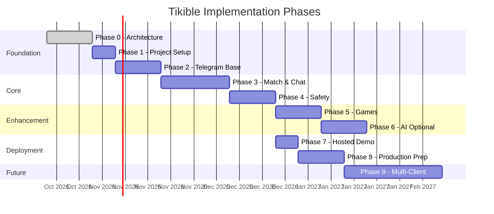

# 02 — Scope & Roadmap

## Purpose

Define the phased implementation plan with explicit dependencies, deliverables, and completion conditions for each phase.

## Scope

This roadmap covers the journey from architecture documentation to a production-capable multi-client platform. Only Phases 0–4 are committed; later phases are planned but subject to revision.

---

## Phase Overview

---

## Phase 0 — Research & Architecture

**Status:** In Progress

### Deliverables

- [ ] Complete documentation directory (`docs/`)
- [ ] All 41 Markdown documents with substantive content
- [ ] Mermaid diagrams for architecture, data flow, state machines
- [ ] Entity-relationship model
- [ ] Security threat model
- [ ] Research sources verified and documented
- [ ] Architecture decisions recorded
- [ ] Documentation consistency audit passed

### Acceptance Criteria

- Every document links to related documents
- No document claims a feature is implemented
- Mermaid diagrams are syntactically valid
- All entities and relationships are consistent across documents
- Unresolved decisions are explicitly marked

### Dependencies

None — this is the starting phase.

---

## Phase 1 — Project Foundation

**Status:** Planned

### Deliverables

- [ ] Repository structure matching documented architecture
- [ ] `pyproject.toml` with pinned dependencies
- [ ] `.env.example` with documented variables
- [ ] FastAPI application skeleton with health endpoints
- [ ] aiogram bot skeleton (long polling for dev)
- [ ] SQLite database initialization with WAL mode
- [ ] Structured logging with redaction
- [ ] Exception handling middleware
- [ ] Ruff + mypy configuration
- [ ] pytest infrastructure with conftest
- [ ] Pre-commit hooks

### Acceptance Criteria

- `pytest` runs with zero failures
- `ruff check` and `mypy` pass cleanly
- Health endpoint returns `200 OK`
- Bot starts in polling mode and responds to `/start` with a placeholder
- Environment variables loaded from `.env`
- No secrets in source code

### Dependencies

- Phase 0 complete

---

## Phase 2 — Secure Telegram Foundation

**Status:** Planned

### Deliverables

- [ ] `/start` with welcome, privacy notice, eligibility check
- [ ] Onboarding conversation flow
- [ ] Profile creation and editing
- [ ] Matching preferences
- [ ] `/profile`, `/settings`, `/help` commands
- [ ] Backend authentication (Telegram adapter → FastAPI)
- [ ] Telegram update deduplication
- [ ] Per-user rate limiting
- [ ] Account deletion (`/delete`)
- [ ] User data removal verification tests

### Acceptance Criteria

- Complete onboarding flow works end-to-end
- Under-18 declaration prevents access
- Profile CRUD operations tested
- Rate limits enforced (unit + integration tests)
- Duplicate updates produce idempotent results
- Account deletion removes all user data
- No Telegram IDs exposed in bot responses

### Dependencies

- Phase 1 complete

---

## Phase 3 — Core Matching & Chat

**Status:** Planned

### Deliverables

- [ ] Match queue with join/leave/expire
- [ ] Deterministic matching algorithm with scoring
- [ ] Atomic match creation (prevents double-matching)
- [ ] Anonymous text message relay
- [ ] `/next` and `/stop` commands
- [ ] Partner disconnect notification
- [ ] Block user functionality
- [ ] Report user with categories
- [ ] Conversation icebreakers (deterministic)
- [ ] Concurrency tests for matchmaking

### Acceptance Criteria

- User cannot match with themselves
- Blocked users excluded from matching
- User cannot be in two active sessions
- Messages cannot leak between sessions
- `/next` atomically ends session and re-queues
- Concurrent match requests preserve invariants (tested)
- Duplicate webhook updates don't create duplicate matches
- Icebreakers displayed on match creation

### Dependencies

- Phase 2 complete

---

## Phase 4 — Safety & Reliability

**Status:** Planned

### Deliverables

- [ ] Authorization regression test suite
- [ ] Concurrency stress tests
- [ ] Abuse control review and hardening
- [ ] Retention policy enforcement (TTL for reports, audit events)
- [ ] Operational diagnostics endpoint
- [ ] Failure recovery tests (DB errors, Telegram API errors)
- [ ] Log audit (no secrets or message contents in logs)
- [ ] Security checklist validation

### Acceptance Criteria

- All tests from [Testing & Quality](25-testing-and-quality.md) §Critical Tests pass
- No secrets or message contents appear in test log output
- Database errors produce graceful user-facing messages
- Telegram API unavailability handled with retry/backoff
- Report retention policy enforced

### Dependencies

- Phase 3 complete

---

## Phase 5 — First Multiplayer Game

**Status:** Planned

### Deliverables

- [ ] Game invitation and acceptance flow
- [ ] Tic-tac-toe implementation (server-authoritative)
- [ ] Inline keyboard game board rendering
- [ ] Turn validation and ownership
- [ ] Timeout and forfeit handling
- [ ] Rematch flow
- [ ] Game-specific tests (all board states, win conditions, draws)
- [ ] Abuse limits for game actions

### Acceptance Criteria

- Game can be started, played, and completed via inline keyboards
- Invalid moves rejected with explanation
- Timeouts forfeit the timed-out player
- Game state validated server-side for every move
- One player cannot submit the other's moves
- Rematch flow works cleanly

### Dependencies

- Phase 3 complete (active chat session required)

---

## Phase 6 — Optional AI

**Status:** Planned

### Deliverables

- [ ] AI provider abstraction layer
- [ ] One low-risk AI feature (icebreaker generation or interest suggestions)
- [ ] Provider configuration (API key, model, timeout, quota)
- [ ] Deterministic fallback when provider unavailable
- [ ] Rate limiting and cost controls
- [ ] Privacy review (what data is sent to provider)

### Acceptance Criteria

- Feature works without AI provider configured
- Provider failure falls back gracefully (no error shown to user)
- API key stored in environment, never logged
- Response validated with Pydantic schema
- Quota limits enforced

### Dependencies

- Phase 4 complete (stability proven)

---

## Phase 7 — Hosted Demonstration

**Status:** Planned

### Deliverables

- [ ] Render deployment configuration (`render.yaml`)
- [ ] Webhook setup and verification
- [ ] Secrets configured via Render environment
- [ ] Health check endpoint validated
- [ ] Deployment smoke tests
- [ ] Persistence behavior documented (ephemeral filesystem impact)
- [ ] Known limitations documented

### Acceptance Criteria

- Bot responds to Telegram commands on Render
- Health check passes Render's monitoring
- Cold start completes within acceptable time
- Webhook secret verified on every request
- Documented: what data survives restarts and what doesn't

### Dependencies

- Phase 4 complete

---

## Phase 8 — Durable Production Preparation

**Status:** Planned

### Deliverables

- [ ] Production storage selected (Supabase PostgreSQL recommended)
- [ ] Migration from SQLite to production database
- [ ] Data migration validation
- [ ] Backup and restoration tested
- [ ] Deployment capacity review
- [ ] Security and privacy review completed
- [ ] Production readiness checklist passed

### Acceptance Criteria

- All data survives instance restarts
- Backup and restore procedure verified
- Migration validates row counts and integrity
- No data loss during migration
- All Phase 4 tests pass against production storage

### Dependencies

- Phase 7 complete
- Production storage budget approved

---

## Phase 9 — Future Clients

**Status:** Design Only

### Deliverables (documented, not implemented)

- [ ] Versioned REST API stabilized
- [ ] Web application authentication (JWT/session)
- [ ] Telegram Mini App authentication (`initData` verification)
- [ ] Shared backend integration contracts
- [ ] Real-time game protocol (WebSocket)
- [ ] Frontend deployment and testing strategy

### Dependencies

- Phase 8 complete
- Frontend technology decision

---

## Related Documents

- [Product Requirements](01-product-requirements.md)
- [Implementation Roadmap](35-implementation-roadmap.md)
- [Acceptance Criteria](36-acceptance-criteria.md)
- [Risk Register](37-risk-register.md)
