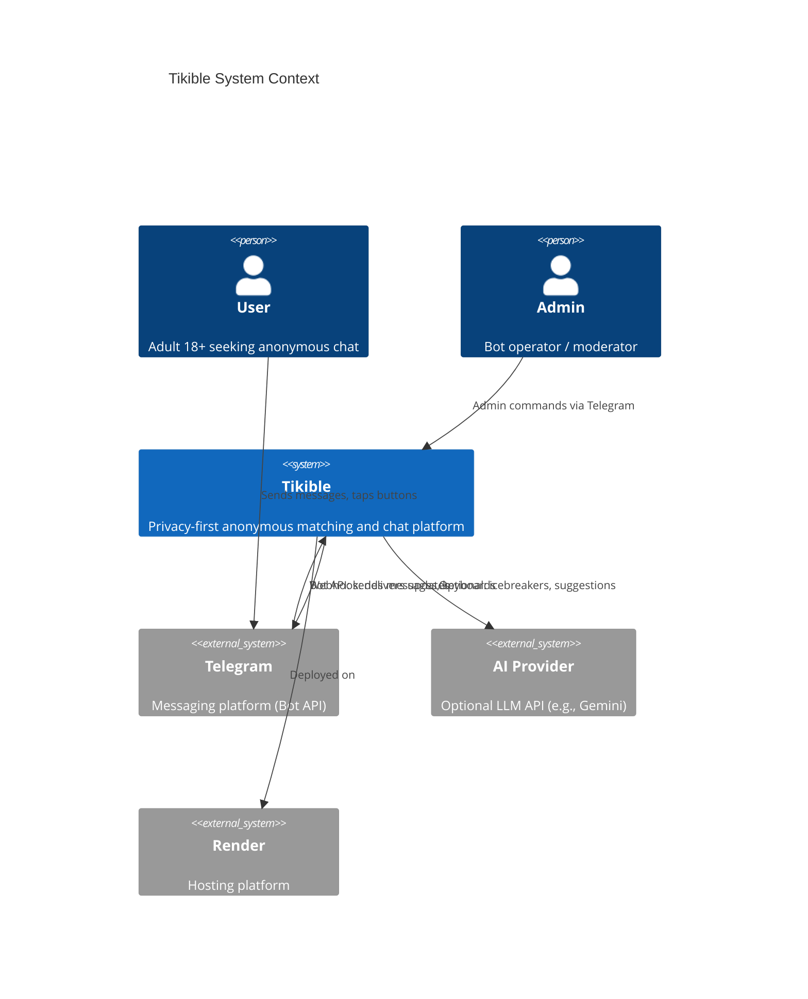
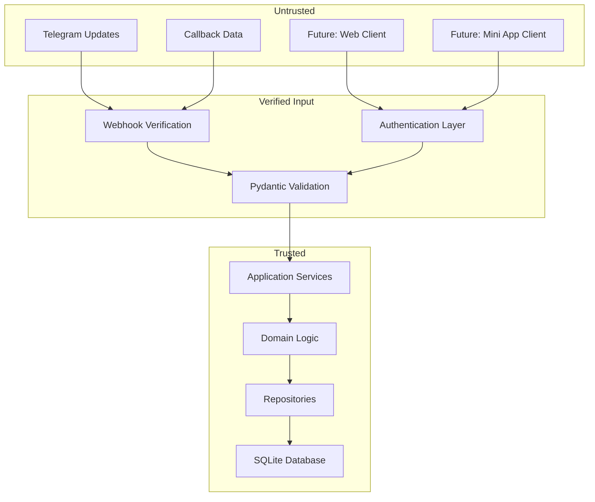
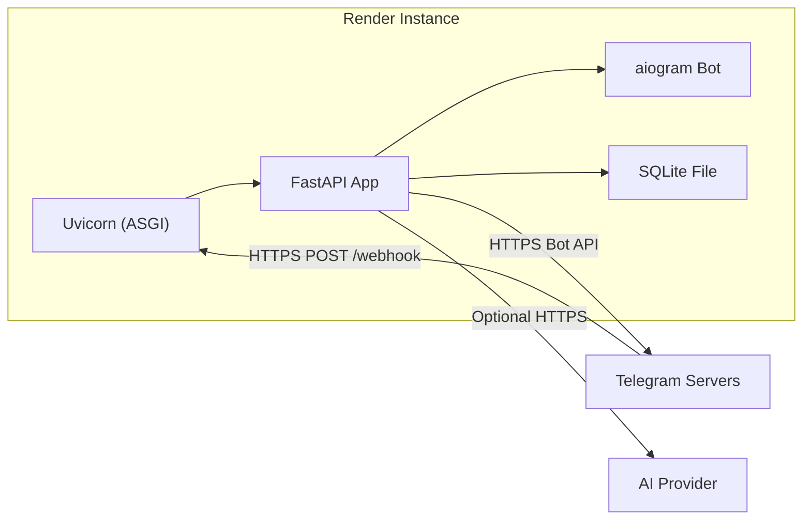

# 04 — System Context

## Purpose

Define the external systems, actors, and boundaries that Tikible interacts with. Establish what is inside and outside the system boundary.

## Scope

Covers all external dependencies for the current MVP (Telegram bot) and identified future integrations.

---

## System Context Diagram

---

## Actors

### Primary Actors

| Actor | Description | Interaction Channel | Authentication |
|---|---|---|---|
| **User** | Adult seeking anonymous chat | Telegram private chat with bot | Telegram user identity (internal only) |
| **Admin** | Bot operator/moderator | Telegram private chat or future admin panel | Telegram user ID checked against admin list |

### External Systems

| System | Role | Protocol | Dependency Level |
|---|---|---|---|
| **Telegram Bot API** | Message delivery, user interaction | HTTPS (webhook inbound, API outbound) | **Critical** — primary user interface |
| **AI Provider** | Optional text generation | HTTPS REST API | **Optional** — fallback always available |
| **Render** | Application hosting | HTTPS | **Critical for deployment** — alternative hosts possible |
| **GitHub** | Source control, CI/CD | HTTPS | **Development** — not runtime dependency |

---

## Boundary Definitions

### Inside the System Boundary

| Component | Responsibility |
|---|---|
| FastAPI Application | Business logic, API endpoints, request handling |
| Telegram Adapter (aiogram) | Translates Telegram updates to application commands |
| Matching Engine | Candidate selection, scoring, match creation |
| Chat Session Manager | Session lifecycle, message relay |
| Game Engine | Game state, move validation, results |
| User Service | Profile, preferences, settings management |
| Safety Service | Blocking, reporting, rate limiting |
| AI Provider Adapter | Optional AI integration with fallbacks |
| Storage Layer | Repository interfaces + SQLite adapter |
| Observability | Logging, health checks, diagnostics |

### Outside the System Boundary

| Component | Owner | What Tikible Controls |
|---|---|---|
| Telegram Platform | Telegram | Nothing — Telegram processes messages, stores user accounts |
| User's Device | User | Nothing — screenshots, screen recording possible |
| AI Provider | Third party | Only request content; provider may log/train on data |
| Render Infrastructure | Render | Deployment config; not hardware, networking, or TLS termination |
| DNS / CDN | Various | Domain configuration only |

---

## Data Flow Across Boundaries

### Inbound

| Source | Data | Entry Point | Validation |
|---|---|---|---|
| Telegram | Webhook updates (JSON) | `POST /webhook` | Secret token header, Pydantic schema |
| Future: Web App | API requests (JSON) | `POST /api/v1/*` | JWT/session token, Pydantic schema |
| Future: Mini App | API requests with `initData` | `POST /api/v1/*` | HMAC verification of `initData` |

### Outbound

| Destination | Data | Exit Point | Sensitivity |
|---|---|---|---|
| Telegram | Bot messages, keyboards | `bot.send_message()` | Contains user-facing text; no private data |
| AI Provider | Interest tags, topic seeds | HTTPS request | **No message content**; only metadata/interests |
| Logs | Structured JSON | stdout/file | Redacted — no secrets, no message content |

---

## Trust Boundaries

### Trust Boundary Rules

1. **Nothing from Telegram is trusted** until the webhook secret is verified and the payload is validated through Pydantic.
2. **Callback data is user-controlled** — never trust callback query data for authorization; always re-verify server-side.
3. **AI provider responses are untrusted** — validate with strict schemas; never execute as code or privileged actions.
4. **Admin commands are verified** by checking the sender's Telegram user ID against a configured admin list, not by trusting message content.

---

## Deployment Context

### Deployment Constraints

- **Single instance** on Render free tier — no horizontal scaling.
- **Ephemeral filesystem** — SQLite file lost on restart (demo only).
- **Cold start ~60s** — first request after sleep may timeout.
- **512 MB RAM, 0.1 CPU** — limits concurrent operations.

See [Render Deployment](28-render-deployment.md) for full deployment architecture.

---

## Related Documents

- [High-Level Architecture](05-high-level-architecture.md)
- [Authentication & Authorization](13-authentication-and-authorization.md)
- [Render Deployment](28-render-deployment.md)
- [Free-Tier & Cost Model](29-free-tier-and-cost-model.md)
- [Security Threat Model](18-security-threat-model.md)
