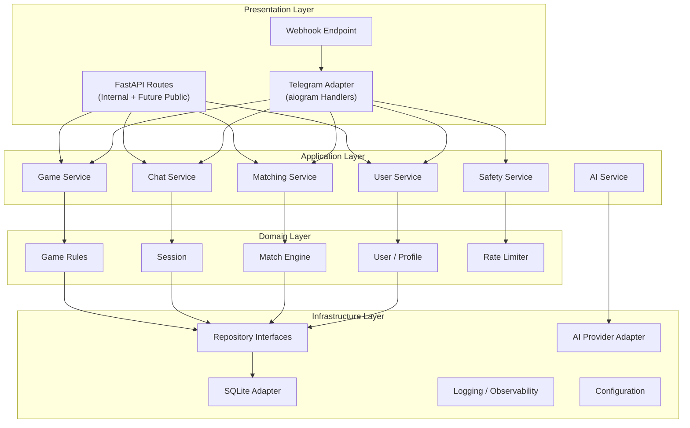
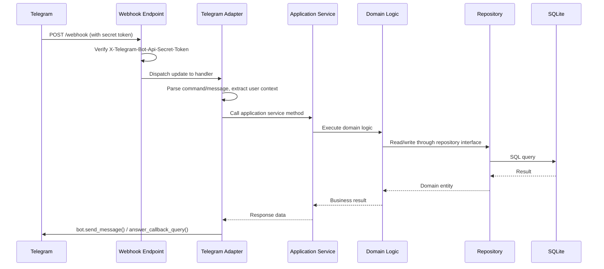
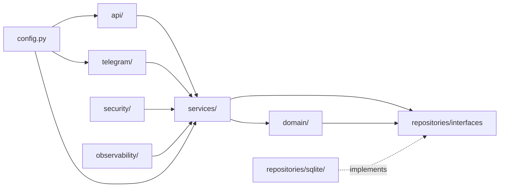
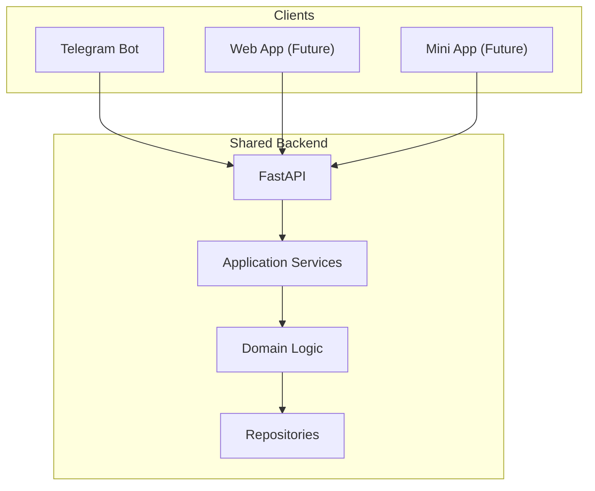

# 05 — High-Level Architecture

## Purpose

Define the layered architecture, module responsibilities, and the flow of control from external clients through the backend to storage.

## Scope

Covers the current Telegram bot architecture and documents how future clients will integrate without restructuring.

---

## Architecture Overview

### Decision: DECIDED — Modular Monolith

Tikible uses a **modular monolith** deployed as a single process. Business logic lives in FastAPI application services. The Telegram bot is an adapter/client of the backend.

### Why Not Microservices?

| Factor | Monolith | Microservices |
|---|---|---|
| Complexity | Simple single deployment | Network boundaries, service discovery, distributed transactions |
| Development speed | Fast iteration | Slower due to inter-service contracts |
| Deployment cost | Single free-tier instance | Multiple instances, higher cost |
| Team size | Single developer/small team | Justified for larger teams |
| Scaling need | Not yet demonstrated | Premature optimization |

**Decision**: Start with a modular monolith. Introduce service boundaries only when measured load or team size justifies the operational overhead.

---

## Layered Architecture



---

## Layer Responsibilities

### Presentation Layer

| Component | Responsibility | Does NOT do |
|---|---|---|
| **Webhook Endpoint** | Receive Telegram updates, verify secret token | Business logic, data access |
| **Telegram Adapter** | Translate Telegram types to application commands; format responses | Make authorization decisions, access storage directly |
| **FastAPI Routes** | Expose internal API for future clients; handle HTTP concerns | Contain domain rules |

### Application Layer

| Service | Responsibility | Key Operations |
|---|---|---|
| **User Service** | User lifecycle, profile, preferences, settings | Create, read, update, delete user |
| **Matching Service** | Queue management, candidate selection, match creation | Join queue, find match, create session |
| **Chat Service** | Session lifecycle, message relay | Relay message, end session, handle disconnect |
| **Game Service** | Game session management | Create game, validate move, determine winner |
| **Safety Service** | Blocking, reporting, rate limiting, moderation | Block user, file report, check rate limit |
| **AI Service** | Optional AI-powered features | Generate icebreaker, suggest topics |

### Domain Layer

| Entity/Rule | Responsibility |
|---|---|
| **User / Profile** | Identity, eligibility, profile data, preferences |
| **Match Engine** | Scoring algorithm, eligibility checks, compatibility |
| **Session** | Session states, participant management, lifecycle rules |
| **Game Rules** | Board state, legal moves, win conditions, turn ownership |
| **Rate Limiter** | Token bucket or sliding window rate limiting |

### Infrastructure Layer

| Component | Responsibility |
|---|---|
| **Repository Interfaces** | Abstract storage contracts per business entity |
| **SQLite Adapter** | Implements repositories using aiosqlite |
| **AI Provider Adapter** | HTTP client for AI APIs with timeout/retry/fallback |
| **Logging** | Structured JSON logging with sensitive field redaction |
| **Configuration** | Typed settings from environment variables |

---

## Request Flow

### Telegram Update → Response



### Key Principles

1. **Unidirectional dependency** — outer layers depend on inner layers, never the reverse.
2. **Telegram adapter never accesses storage directly** — always goes through application services.
3. **Domain layer has no framework dependencies** — pure Python classes and functions.
4. **Repository interface defined in domain** — implementation in infrastructure.
5. **All validation at the boundary** — Pydantic models validate input before reaching services.

---

## Module Map

```
src/tikible/
├── main.py                 # FastAPI app creation, lifespan, middleware
├── config.py               # Settings from environment variables
│
├── api/                    # FastAPI route handlers
│   ├── __init__.py
│   ├── health.py           # /health, /ready endpoints
│   ├── webhook.py          # POST /webhook — Telegram updates
│   └── internal.py         # Internal API routes (future)
│
├── telegram/               # aiogram adapter layer
│   ├── __init__.py
│   ├── bot.py              # Bot initialization
│   ├── dispatcher.py       # Dispatcher and router setup
│   ├── handlers/           # Command and message handlers
│   │   ├── __init__.py
│   │   ├── start.py        # /start, onboarding
│   │   ├── profile.py      # /profile
│   │   ├── settings.py     # /settings
│   │   ├── match.py        # Match queue interaction
│   │   ├── chat.py         # Message relay
│   │   ├── games.py        # Game commands and callbacks
│   │   ├── safety.py       # /block, /report
│   │   └── help.py         # /help
│   ├── keyboards.py        # Inline keyboard builders
│   ├── formatting.py       # Safe message formatting
│   └── middleware.py       # Rate limiting, logging, auth
│
├── services/               # Application services
│   ├── __init__.py
│   ├── user_service.py
│   ├── matching_service.py
│   ├── chat_service.py
│   ├── game_service.py
│   ├── safety_service.py
│   └── ai_service.py
│
├── domain/                 # Domain entities and rules
│   ├── __init__.py
│   ├── entities.py         # User, Profile, Session, etc.
│   ├── matching.py         # Matching algorithm
│   ├── games/              # Game rule engines
│   │   ├── __init__.py
│   │   ├── base.py         # Abstract game interface
│   │   └── tictactoe.py    # Tic-tac-toe rules
│   ├── rate_limiting.py    # Rate limit logic
│   └── exceptions.py       # Domain exceptions
│
├── repositories/           # Storage interfaces and adapters
│   ├── __init__.py
│   ├── interfaces.py       # Abstract repository contracts
│   ├── sqlite/             # SQLite implementation
│   │   ├── __init__.py
│   │   ├── adapter.py      # Connection management
│   │   ├── user_repo.py
│   │   ├── session_repo.py
│   │   ├── game_repo.py
│   │   ├── safety_repo.py
│   │   └── migrations.py   # Schema versioning
│   └── memory/             # In-memory for testing
│       ├── __init__.py
│       └── repositories.py
│
├── security/               # Security utilities
│   ├── __init__.py
│   ├── webhook.py          # Webhook secret verification
│   ├── auth.py             # Internal API authentication
│   └── redaction.py        # Log field redaction
│
└── observability/          # Monitoring and diagnostics
    ├── __init__.py
    ├── logging.py           # Structured logging setup
    └── health.py            # Health check logic
```

---

## Dependency Direction



**Rule**: Arrows point from outer layers to inner layers. `repositories/sqlite/` implements the interface defined by `repositories/interfaces.py` but is injected at startup, never imported directly by services.

---

## Future Client Integration



All clients use the **same application services, domain rules, and storage**. No business logic is duplicated in client adapters.

---

## Related Documents

- [Module Boundaries](06-module-boundaries.md)
- [Domain Model](07-domain-model.md)
- [API Contracts](12-api-contracts.md)
- [Authentication & Authorization](13-authentication-and-authorization.md)
- [Architecture Decisions](39-architecture-decisions.md)
