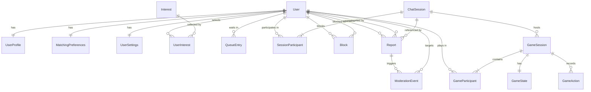
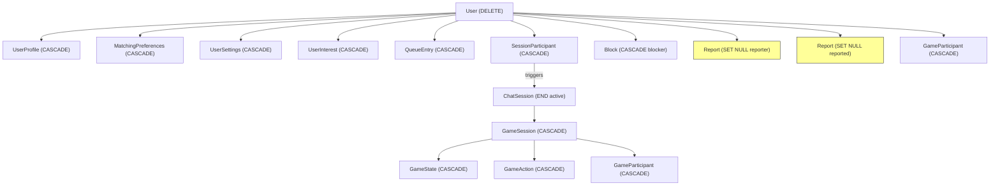

# 08 — Entity Relationships

## Purpose

Define the relationships between all domain entities using ER diagrams, relationship matrices, and referential integrity rules.

## Scope

Covers all persistent and ephemeral entities from the [Domain Model](07-domain-model.md).

---

## Entity-Relationship Diagram

---

## Relationship Matrix

| Entity A | Relationship | Entity B | Cardinality | Ownership | On A Delete | On B Delete |
|---|---|---|---|---|---|---|
| User | has | UserProfile | 1:1 | User owns Profile | Cascade delete | N/A |
| User | has | MatchingPreferences | 1:1 | User owns Prefs | Cascade delete | N/A |
| User | has | UserSettings | 1:1 | User owns Settings | Cascade delete | N/A |
| User | selects | Interest (via UserInterest) | M:N | User owns junction | Delete junction rows | Keep interest; delete junction |
| User | waits in | QueueEntry | 1:0..1 | System-managed | Remove from queue | N/A |
| User | participates in | ChatSession (via SessionParticipant) | 1:0..N | System-managed | End active sessions | N/A |
| User | blocks | User (via Block) | M:N | Blocker owns | Delete blocker's blocks | Anonymize blocked reference |
| User | reports | User (via Report) | M:N | System-managed | Anonymize reporter | Anonymize reported |
| ChatSession | contains | SessionParticipant | 1:2 | Session owns | N/A | End session |
| ChatSession | hosts | GameSession | 1:0..N | Session owns | Cascade delete | N/A |
| ChatSession | referenced by | Report | 1:0..N | Report references | Nullify FK | N/A |
| GameSession | contains | GameParticipant | 1:2 | Game owns | N/A | N/A |
| GameSession | has | GameState | 1:1 | Game owns | Cascade delete | N/A |
| GameSession | records | GameAction | 1:0..N | Game owns | Cascade delete | N/A |
| Report | triggers | ModerationEvent | 1:0..N | System-managed | Cascade delete | N/A |

---

## Referential Integrity Rules

### Primary Keys

| Entity | PK | Type | Generation |
|---|---|---|---|
| User | `id` | UUID (string) | `uuid4()` at creation |
| UserProfile | `user_id` | FK to User | Same as User.id |
| MatchingPreferences | `user_id` | FK to User | Same as User.id |
| UserSettings | `user_id` | FK to User | Same as User.id |
| Interest | `id` | String | System-defined |
| UserInterest | (`user_id`, `interest_id`) | Composite FK | — |
| QueueEntry | `user_id` | FK to User | — |
| ChatSession | `id` | UUID (string) | `uuid4()` at creation |
| SessionParticipant | (`session_id`, `user_id`) | Composite FK | — |
| Block | `id` | UUID (string) | `uuid4()` at creation |
| Report | `id` | UUID (string) | `uuid4()` at creation |
| GameSession | `id` | UUID (string) | `uuid4()` at creation |
| GameParticipant | (`game_id`, `user_id`) | Composite FK | — |
| GameState | `game_id` | FK to GameSession | — |
| GameAction | `id` | UUID (string) | `uuid4()` at creation |

### Unique Constraints

| Entity | Constraint | Purpose |
|---|---|---|
| User | `UNIQUE(telegram_id)` | One account per Telegram user |
| UserProfile | `UNIQUE(user_id)` | One profile per user |
| MatchingPreferences | `UNIQUE(user_id)` | One preference set per user |
| UserSettings | `UNIQUE(user_id)` | One settings record per user |
| UserInterest | `UNIQUE(user_id, interest_id)` | No duplicate selections |
| QueueEntry | `UNIQUE(user_id)` | User can only be in queue once |
| SessionParticipant | `UNIQUE(session_id, user_id)` | User in session at most once |
| Block | `UNIQUE(blocker_id, blocked_id)` | No duplicate blocks |
| GameParticipant | `UNIQUE(game_id, user_id)` | Player in game at most once |
| GameState | `UNIQUE(game_id)` | One state per game |

### Foreign Key Behavior

| FK | On Delete Parent | Rationale |
|---|---|---|
| UserProfile.user_id → User.id | CASCADE | Profile meaningless without user |
| MatchingPreferences.user_id → User.id | CASCADE | Preferences meaningless without user |
| UserSettings.user_id → User.id | CASCADE | Settings meaningless without user |
| UserInterest.user_id → User.id | CASCADE | Junction row meaningless without user |
| QueueEntry.user_id → User.id | CASCADE | Queue entry meaningless without user |
| SessionParticipant.user_id → User.id | CASCADE | Clean up participant references |
| SessionParticipant.session_id → ChatSession.id | CASCADE | Participants belong to session |
| Block.blocker_id → User.id | CASCADE | Block record meaningless without blocker |
| Block.blocked_id → User.id | SET NULL | Retain block for safety review |
| Report.reporter_id → User.id | SET NULL | Anonymize but retain report |
| Report.reported_id → User.id | SET NULL | Anonymize but retain report |
| Report.session_id → ChatSession.id | SET NULL | Session reference optional |
| GameSession.chat_session_id → ChatSession.id | CASCADE | Game belongs to chat session |
| GameParticipant.game_id → GameSession.id | CASCADE | Participant belongs to game |
| GameParticipant.user_id → User.id | CASCADE | Clean up references |
| GameState.game_id → GameSession.id | CASCADE | State belongs to game |
| GameAction.game_id → GameSession.id | CASCADE | Action belongs to game |
| GameAction.user_id → User.id | CASCADE | Action belongs to player |

---

## Transactional Boundaries

### Match Creation Transaction

The following operations MUST be atomic:

1. Remove both users from queue (`DELETE QueueEntry` × 2)
2. Create `ChatSession`
3. Create `SessionParticipant` × 2
4. Update user states if applicable

**SQLite implementation**: Single `BEGIN IMMEDIATE` transaction.

### Session Termination Transaction

Atomic:

1. Update `ChatSession.status` → `ENDED`
2. Update `SessionParticipant.left_at` for both participants
3. Optionally enqueue requesting user (if `/next`)

### Block + Session End Transaction

Atomic:

1. Create `Block` record
2. End active session (if blocking current partner)
3. Notify partner of disconnect

### Account Deletion Transaction

Atomic:

1. Delete UserProfile
2. Delete MatchingPreferences
3. Delete UserSettings
4. Delete UserInterest entries
5. Delete QueueEntry
6. End active sessions
7. Delete Block records (where blocker)
8. Anonymize Report records (SET NULL reporter/reported)
9. Delete GameParticipant entries
10. Delete User record

---

## Deletion & Retention Dependency Map

> [!NOTE]
> Reports are **anonymized** (SET NULL on reporter/reported fields) rather than deleted, preserving safety records while removing personally identifiable information.

---

## Related Documents

- [Domain Model](07-domain-model.md)
- [Data Flow](09-data-flow.md)
- [State Machines](10-state-machines.md)
- [Storage & Persistence](20-storage-and-persistence.md)
- [Privacy & Data Governance](19-privacy-and-data-governance.md)
