# 09 — Data Flow

## Purpose

Document the sequence of operations for every major user flow, identifying actors, validation, state changes, storage operations, and error handling.

## Scope

Covers all MVP flows and selected future flows for architectural reference.

---

## 1. `/start` and Onboarding

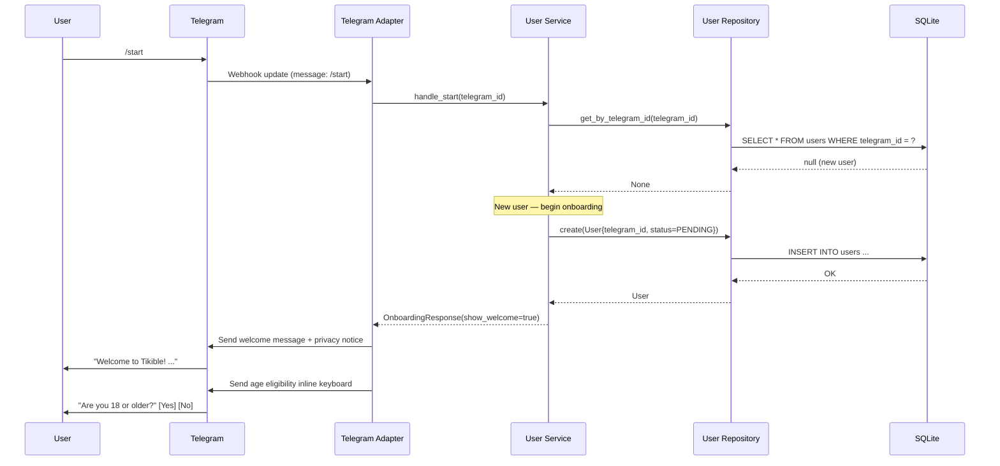

**Returning user flow:**
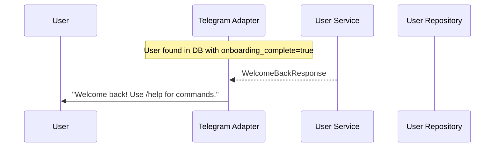

### Flow Details

| Aspect | Detail |
|---|---|
| **Initiating Actor** | User |
| **Input** | `/start` command |
| **Validation** | Telegram update verified via webhook secret |
| **Auth** | Telegram identity (internal mapping) |
| **Transaction** | Single INSERT for new user |
| **State Change** | User: (none) → PENDING |
| **Error** | DB failure → "Sorry, please try again later" |
| **Idempotency** | Re-sending `/start` for existing user returns welcome-back |
| **Data NOT Persisted** | Message content |

---

## 2. Profile Creation

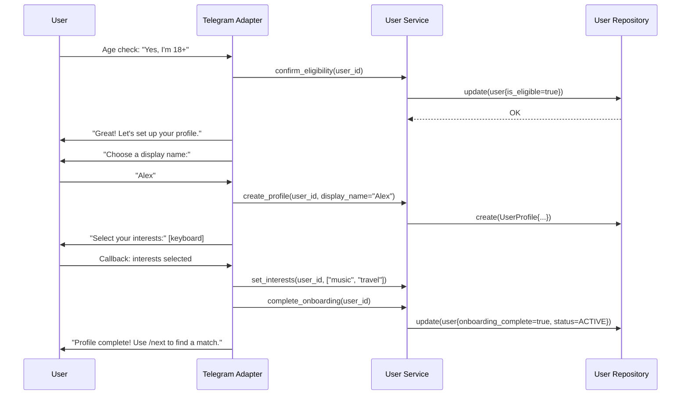

| Aspect | Detail |
|---|---|
| **Transaction** | Profile + interests + status update in single transaction |
| **State Change** | User: PENDING → ACTIVE |
| **Validation** | Display name: 2–30 chars, no URLs, no prohibited patterns |
| **Error** | Invalid name → re-prompt with explanation |

---

## 3. Joining the Matching Queue

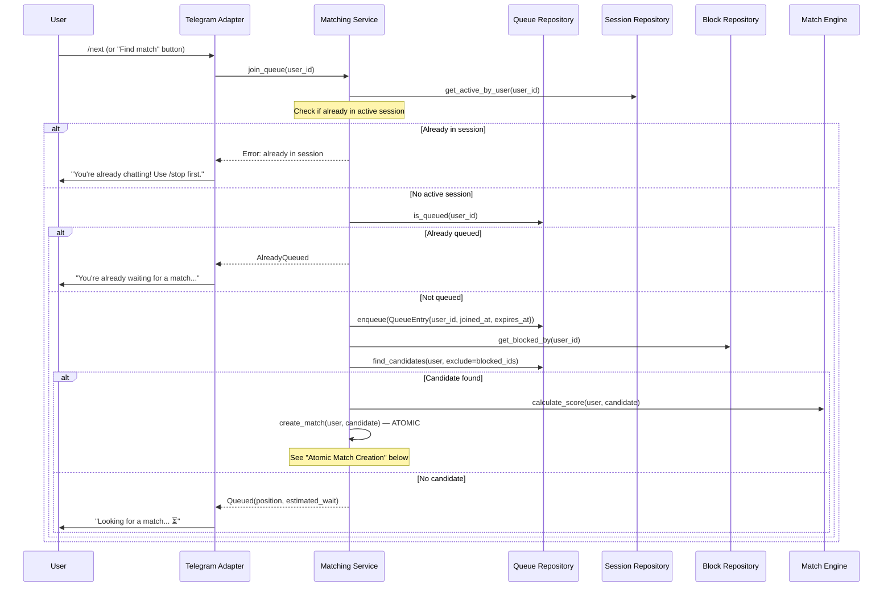

---

## 4. Atomic Match Creation

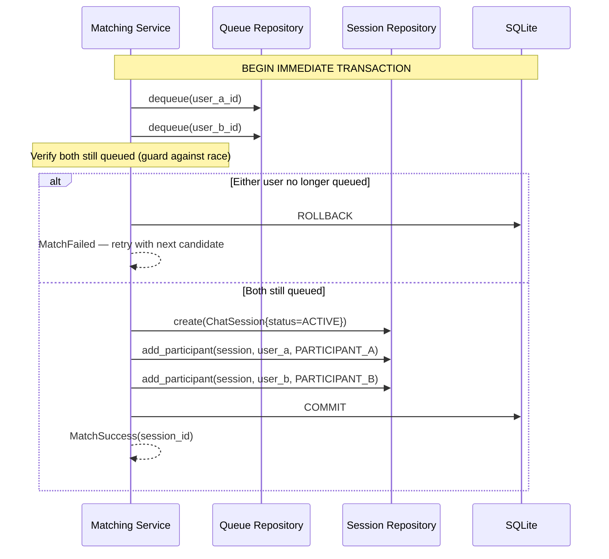

### Concurrency Safety

| Invariant | Enforcement |
|---|---|
| User cannot be matched twice | `BEGIN IMMEDIATE` + verify-then-commit |
| Self-matching impossible | Candidate query excludes requesting user |
| Blocked users excluded | Block check before candidate selection |
| Active session prevents queue join | Session check at queue entry |
| Stale queue entries cleaned | `expires_at` checked; periodic cleanup |
| Webhook retries safe | `update_id` deduplication prevents double-processing |

---

## 5. Message Relay

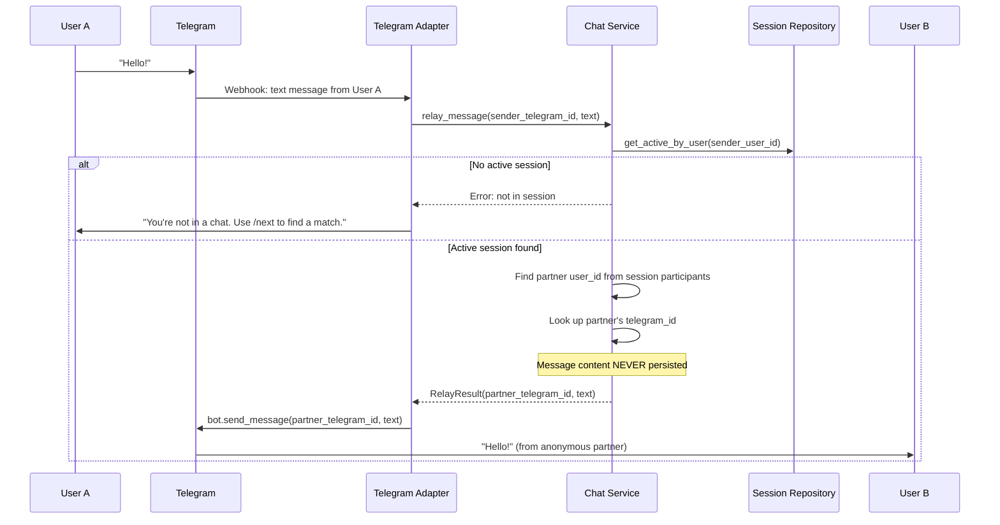

| Aspect | Detail |
|---|---|
| **Auth** | Sender must be participant in the active session |
| **Content** | Text only (MVP); media handling is future |
| **Persistence** | **NOTHING stored** — message relayed and discarded |
| **Rate Limit** | Max 30 messages/minute per user |
| **Error** | Partner blocked bot → notify sender "Partner unavailable" |

---

## 6. `/stop` — End Session

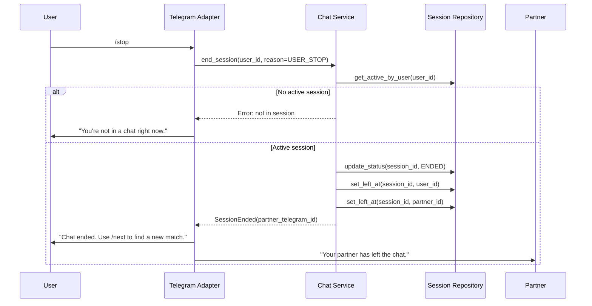

---

## 7. `/next` — End and Re-queue

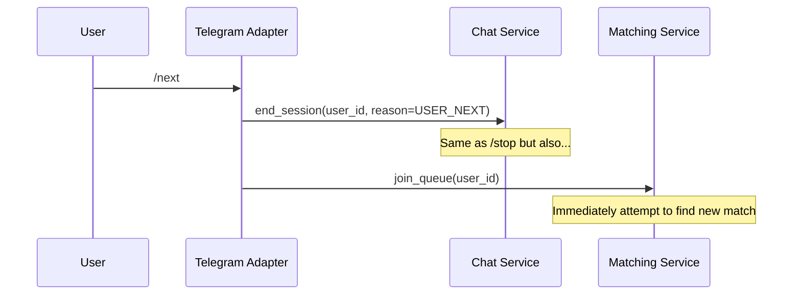

| Aspect | Detail |
|---|---|
| **Transaction** | End session + enqueue in atomic transaction |
| **State Change** | Session: ACTIVE → ENDED; User → queued |
| **Race Condition** | `/next` while being matched by another user — handle via BEGIN IMMEDIATE |

---

## 8. Blocking a Participant

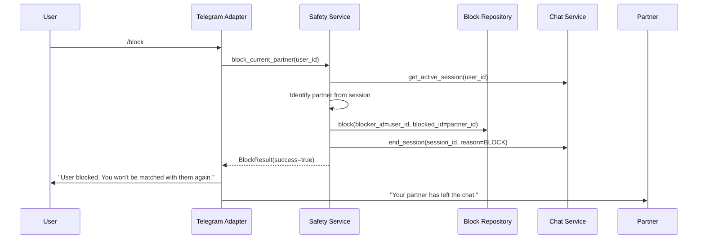

| Aspect | Detail |
|---|---|
| **Privacy** | Partner is NOT told they were blocked; message says "left" |
| **Transaction** | Block + session end atomic |
| **Idempotency** | Blocking already-blocked user is a no-op |

---

## 9. Reporting Abuse

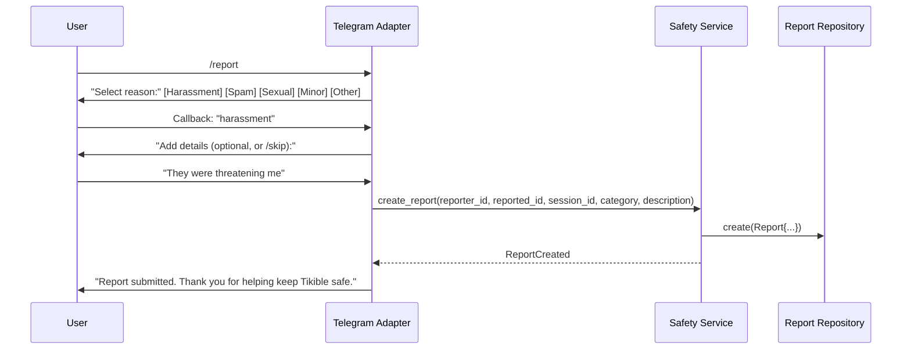

| Aspect | Detail |
|---|---|
| **Retention** | Reports retained 90 days then anonymized |
| **Content** | Description may contain sensitive content — stored encrypted at rest when possible |
| **Access** | Only admin can view reports |
| **No auto-action** | Reports are not auto-actioned; human review required |

---

## 10. Account Deletion

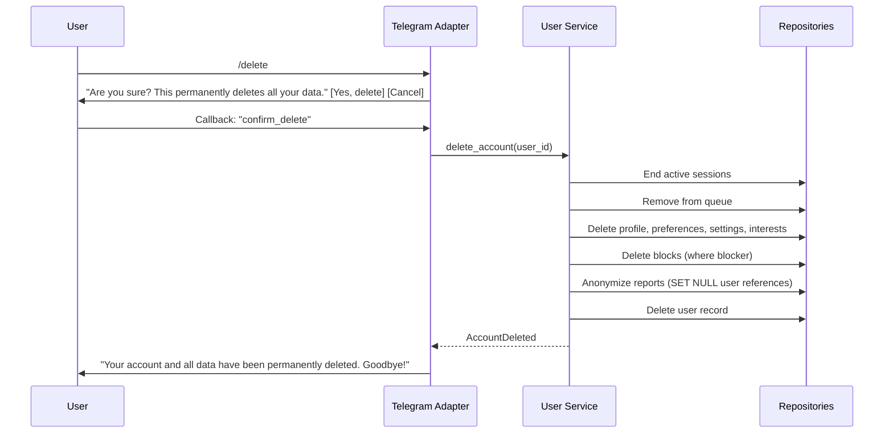

---

## 11. Starting a Multiplayer Game

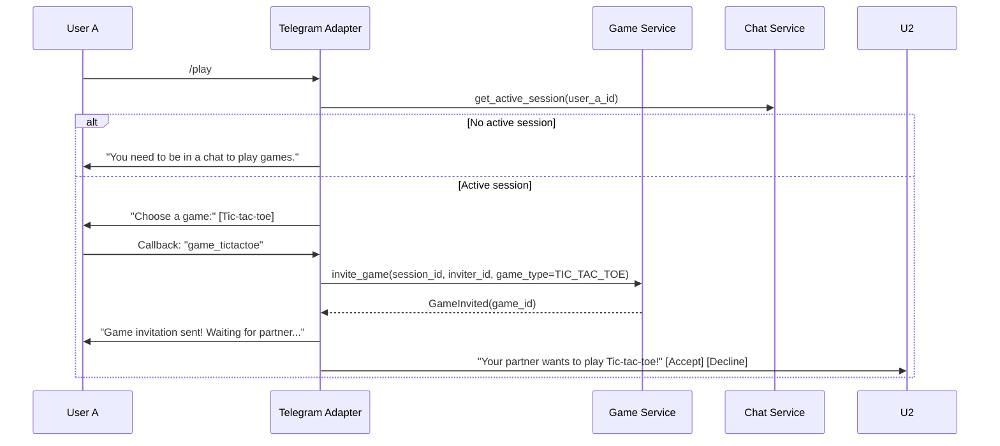

---

## 12. Submitting a Game Move

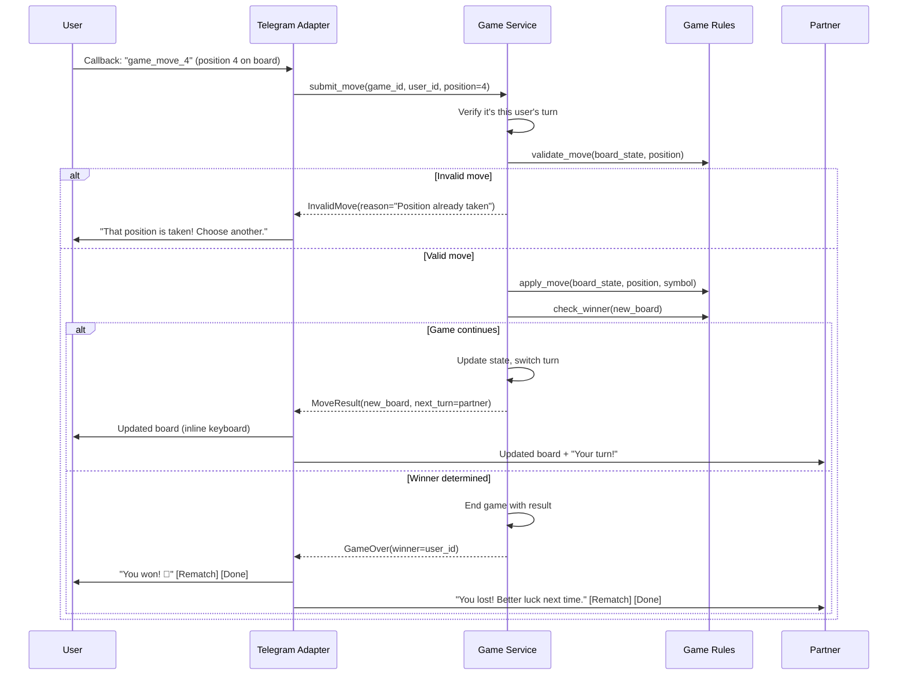

---

## 13. Webhook Verification and Processing

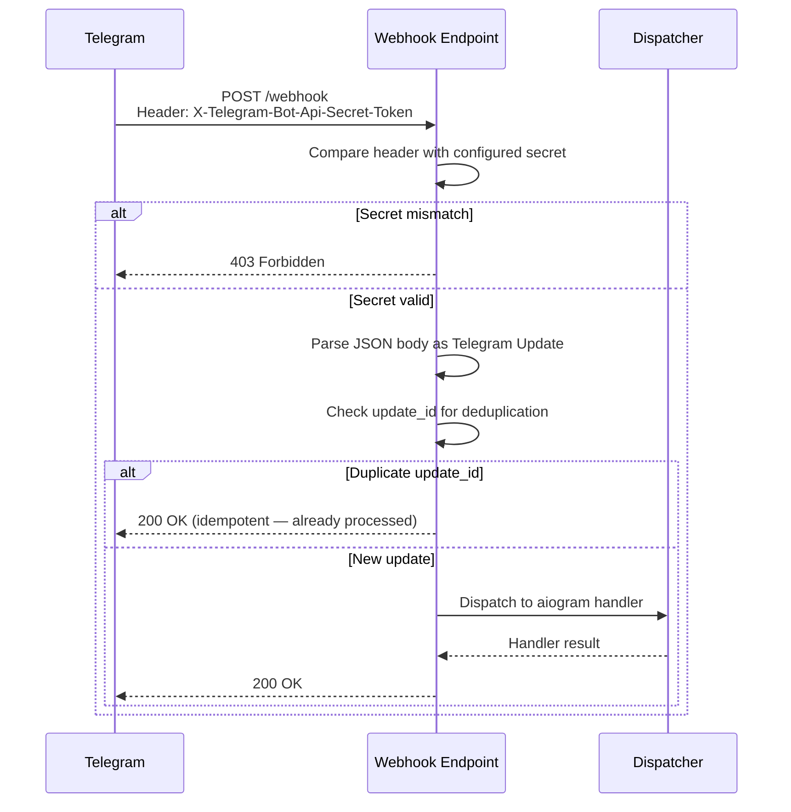

---

## 14. Duplicate Update Handling

| Scenario | Cause | Handling |
|---|---|---|
| Same `update_id` received twice | Telegram retry on timeout | Track recent `update_id`s in memory; skip duplicates |
| `/next` sent twice rapidly | User double-tap | Idempotent — second call sees user already queued |
| Match + `/stop` race | User stops while being matched | `BEGIN IMMEDIATE` ensures atomic state check |
| Block during message relay | Timing overlap | Message delivery failure handled gracefully |

---

## 15. Future: Migration from SQLite to Supabase

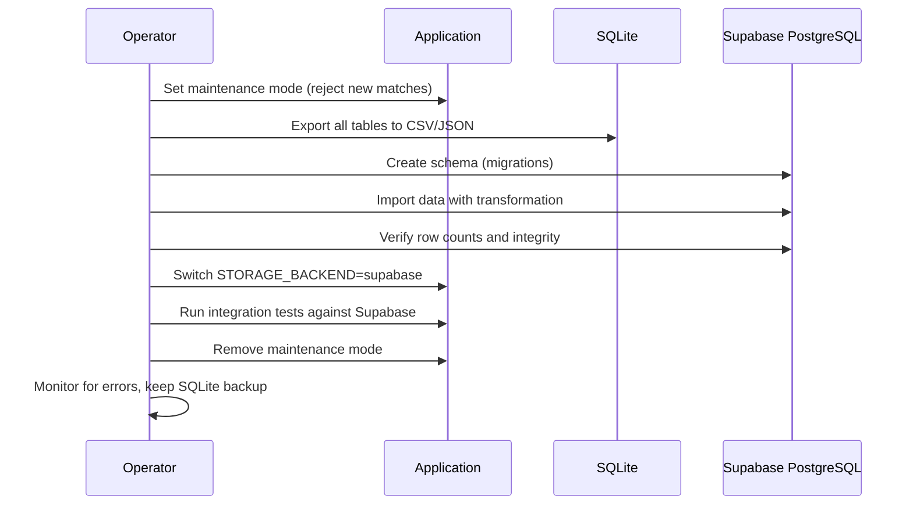

See [Data Migration Runbook](23-data-migration-runbook.md) for complete procedure.

---

## Related Documents

- [Entity Relationships](08-entity-relationships.md)
- [State Machines](10-state-machines.md)
- [Matching Engine](14-matching-engine.md)
- [Chat Session Lifecycle](15-chat-session-lifecycle.md)
- [Multiplayer Games](16-multiplayer-games.md)
- [Performance & Concurrency](26-performance-and-concurrency.md)
