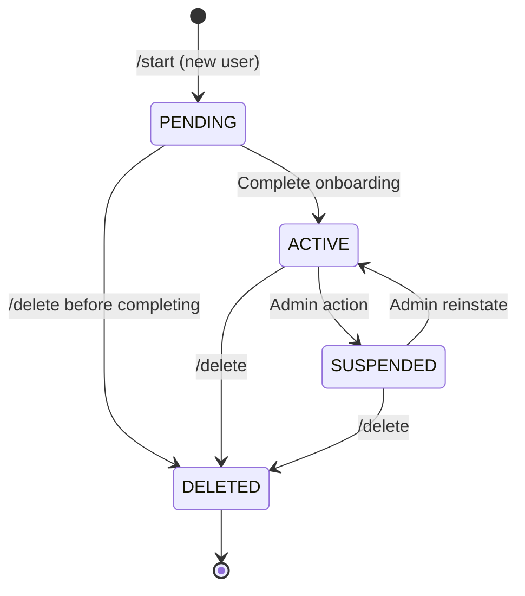
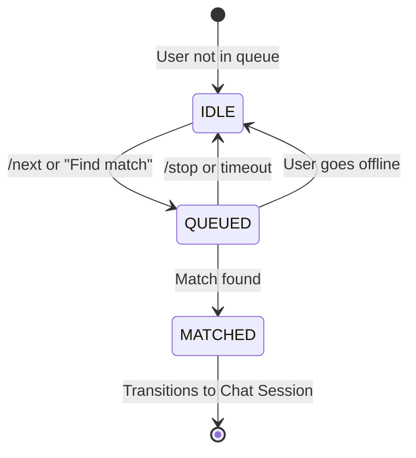
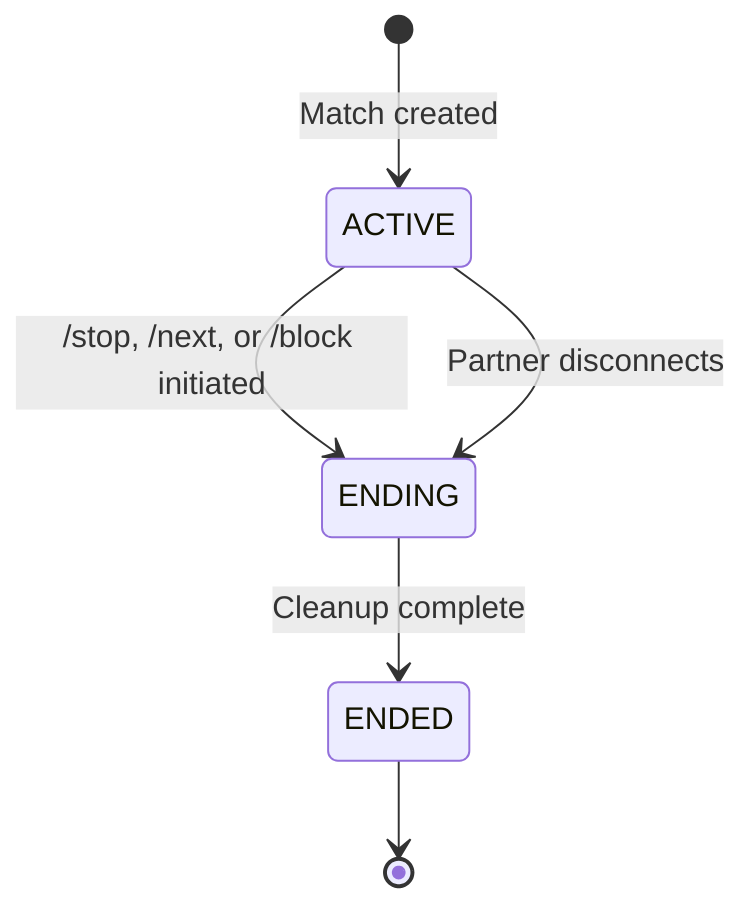
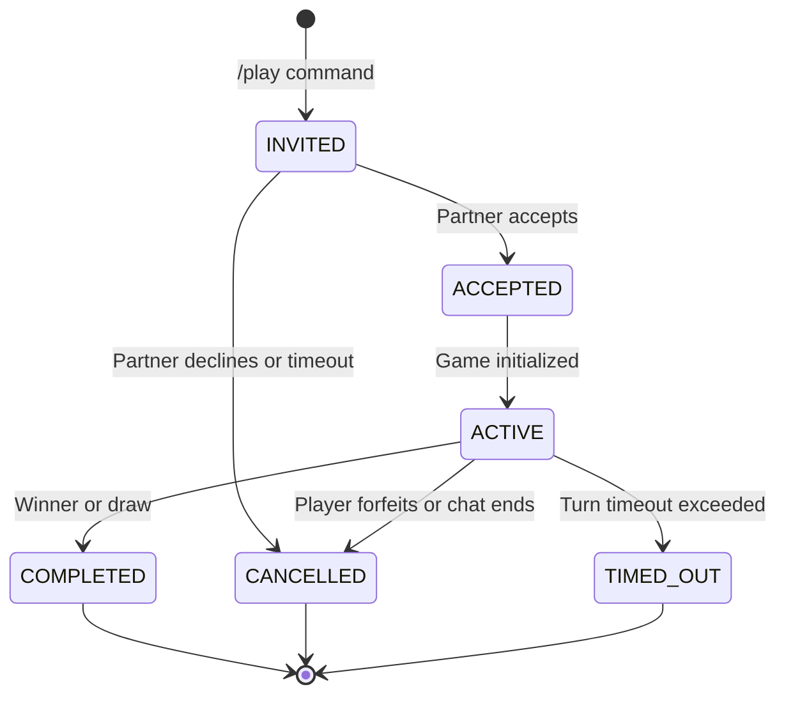
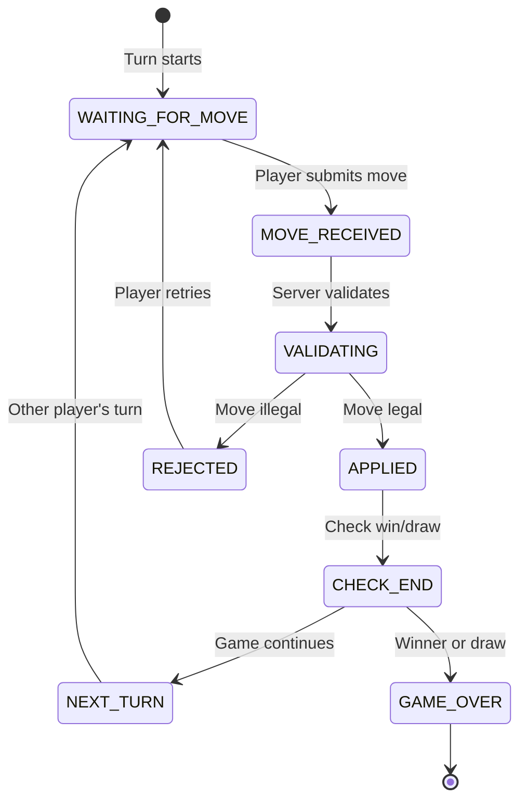
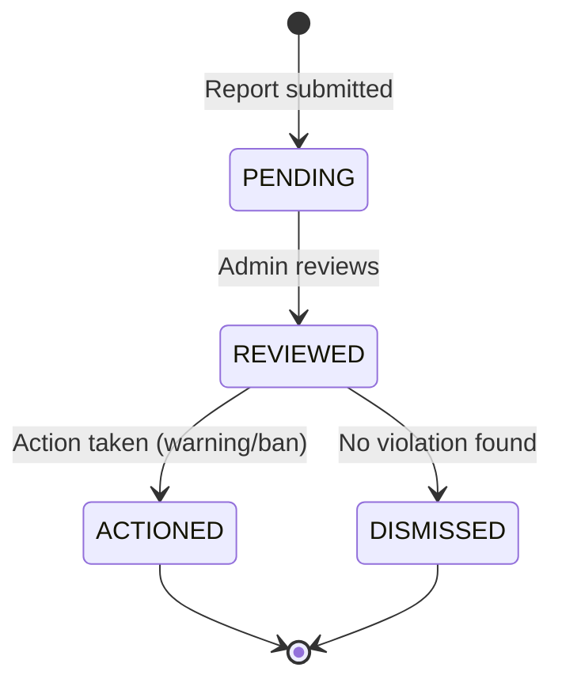
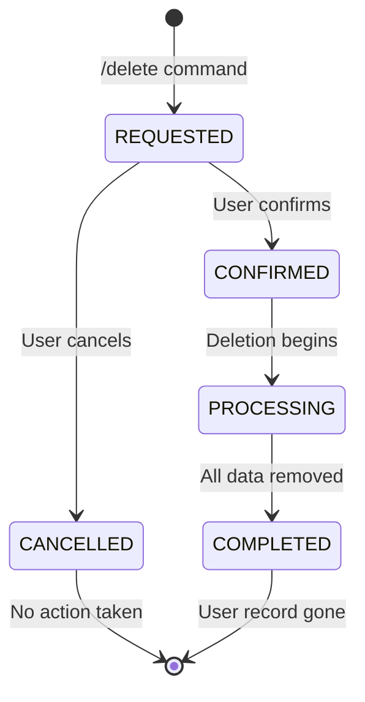

# 10 — State Machines

## Purpose

Define explicit states and valid transitions for all stateful entities. Establish rules for handling invalid transitions, timeouts, and concurrent state changes.

## Scope

Covers User lifecycle, matchmaking queue, chat session, game session, and reporting.

---

## 1. User Lifecycle



| Transition | Trigger | Preconditions | Side Effects |
|---|---|---|---|
| `[*] → PENDING` | `/start` from new Telegram user | No existing user with this telegram_id | Create User record |
| `PENDING → ACTIVE` | Complete onboarding (profile + eligibility) | `is_eligible=true`, profile created | User can now match |
| `ACTIVE → SUSPENDED` | Admin moderation action | Active report against user | End active sessions; remove from queue |
| `SUSPENDED → ACTIVE` | Admin reinstatement | Admin review complete | User can match again |
| `* → DELETED` | User requests `/delete` | Confirmation required | Cascade delete all data (see [Entity Relationships](08-entity-relationships.md)) |

### Invalid Transition Handling

| Attempted | From State | Response |
|---|---|---|
| Match request | PENDING | "Please complete your profile first." |
| Match request | SUSPENDED | "Your account is suspended. Contact support." |
| Profile edit | DELETED | Not reachable — user record gone |

---

## 2. Matchmaking Queue



| Transition | Trigger | Preconditions | Side Effects |
|---|---|---|---|
| `IDLE → QUEUED` | User requests match | User ACTIVE, no active session, not already queued | Create QueueEntry |
| `QUEUED → MATCHED` | Compatible candidate found | Both users still queued, not blocked | Create ChatSession atomically |
| `QUEUED → IDLE` | `/stop` or queue timeout | User in queue | Remove QueueEntry |
| `QUEUED → IDLE` | User blocks bot or goes offline | Detected on next interaction | Remove QueueEntry |

### Queue Timeout

- Default: **5 minutes**
- On timeout: Remove from queue, notify user "No match found. Try again later."
- Periodic cleanup removes stale entries (expired `expires_at`)

### Concurrency Rules

1. `BEGIN IMMEDIATE` transaction for match creation
2. Verify both users still queued inside transaction
3. If either was already dequeued → rollback, try next candidate
4. Queue entry has UNIQUE constraint on `user_id` — prevents double-queuing

---

## 3. Chat Session



| Transition | Trigger | Preconditions | Side Effects |
|---|---|---|---|
| `[*] → ACTIVE` | Match creation | Two users atomically removed from queue | Both participants notified; icebreaker sent |
| `ACTIVE → ENDING` | `/stop` by either user | Session is ACTIVE | Initiating user notified of end |
| `ACTIVE → ENDING` | `/next` by either user | Session is ACTIVE | Initiating user re-queued |
| `ACTIVE → ENDING` | `/block` by either user | Session is ACTIVE | Block recorded; partner told "partner left" |
| `ACTIVE → ENDING` | Partner blocks bot / unreachable | Message delivery fails | Notify remaining user "Partner unavailable" |
| `ENDING → ENDED` | Cleanup operations complete | Both participants updated | Session record preserved (metadata only) |

### Session Invariants

1. A session has exactly **2 participants**.
2. A user can have at most **1 active session** at any time.
3. Messages can only be relayed in `ACTIVE` state.
4. `ENDED` sessions are never reactivated.

### Timeout Rules

| Scenario | Timeout | Action |
|---|---|---|
| No messages for 30 minutes | Session idle timeout | Warn both users; end if no response in 5 minutes |
| Partner unreachable (bot blocked) | Immediate on detection | End session, notify remaining user |

---

## 4. Game Session



| Transition | Trigger | Preconditions | Side Effects |
|---|---|---|---|
| `[*] → INVITED` | `/play` command | Active chat session, no active game in session | Send invitation to partner |
| `INVITED → ACCEPTED` | Partner clicks "Accept" | Invitation not expired (60s) | Initialize game state |
| `INVITED → CANCELLED` | Partner clicks "Decline" or 60s timeout | — | Notify inviter |
| `ACCEPTED → ACTIVE` | Game state initialized | Board created, turns assigned | Display board to both players |
| `ACTIVE → COMPLETED` | Win condition or draw detected | Valid move processed | Announce result, offer rematch |
| `ACTIVE → CANCELLED` | Chat session ends or player forfeits | — | Game abandoned |
| `ACTIVE → TIMED_OUT` | Turn timer exceeds 120s | Player didn't move in time | Opponent wins by timeout |

### Game Turn Lifecycle



---

## 5. Report Lifecycle



| Transition | Trigger | Preconditions | Side Effects |
|---|---|---|---|
| `[*] → PENDING` | User submits report | Active or recent session | Report stored with category |
| `PENDING → REVIEWED` | Admin opens report | Admin access verified | — |
| `REVIEWED → ACTIONED` | Admin issues warning/suspension | — | ModerationEvent created; user notified |
| `REVIEWED → DISMISSED` | Admin finds no violation | — | Report closed |

---

## 6. Account Deletion



| Step | Action | Failure Behavior |
|---|---|---|
| End active sessions | Close chat, notify partner | Retry; if fails, log and continue |
| Remove from queue | Delete QueueEntry | Idempotent |
| Delete user data | Cascade delete profile, prefs, settings, interests | Transaction — all or nothing |
| Anonymize reports | SET NULL on reporter/reported | Must succeed for safety |
| Delete user record | Final DELETE | Confirms completion |

---

## State Machine Rules

### Single Source of Truth

Each entity's state is stored in exactly one place:
- User status → `users.status` column
- Session status → `chat_sessions.status` column
- Game status → `game_sessions.status` column
- Queue status → presence/absence in `queue_entries` table

### Invalid Transition Handling

All state transitions go through service methods that:
1. Read current state
2. Validate transition is legal
3. Apply new state atomically
4. Return result or error

```python
# Example: services/chat_service.py
async def end_session(self, user_id: str, reason: EndReason) -> SessionEndResult:
    session = await self._session_repo.get_active_by_user(user_id)
    if session is None:
        return SessionEndResult(error="NOT_IN_SESSION")
    if session.status != SessionStatus.ACTIVE:
        return SessionEndResult(error="SESSION_NOT_ACTIVE")

    # Atomic transition
    await self._session_repo.update_status(session.id, SessionStatus.ENDED)
    ...
```

### Duplicate Event Protection

| Event | Protection |
|---|---|
| `/start` for existing user | Check user exists → return welcome-back |
| Double `/next` | Check already queued → return "already waiting" |
| `/stop` on ended session | Check status → return "not in chat" |
| Double game move | Check turn ownership → reject |

---

## Related Documents

- [Domain Model](07-domain-model.md)
- [Entity Relationships](08-entity-relationships.md)
- [Data Flow](09-data-flow.md)
- [Matching Engine](14-matching-engine.md)
- [Chat Session Lifecycle](15-chat-session-lifecycle.md)
- [Multiplayer Games](16-multiplayer-games.md)
