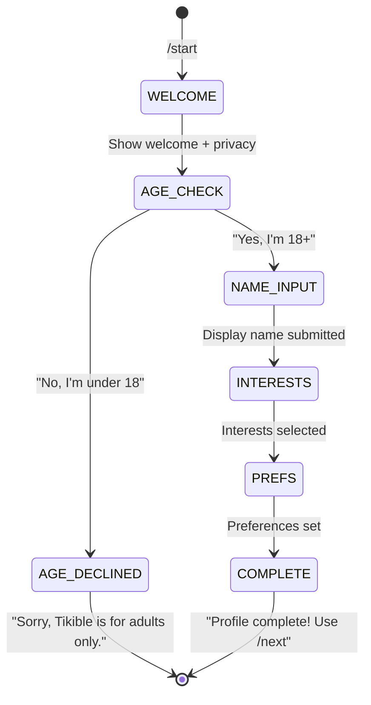

# 11 — Telegram Bot Design

## Purpose

Document the Telegram bot's command taxonomy, conversation flows, keyboard layouts, message formatting, and platform-specific constraints.

## Scope

Covers the aiogram 3.x adapter layer for the MVP Telegram bot.

---

## Command Taxonomy

### User Commands

| Command | Scope | Description | Requires Profile |
|---|---|---|---|
| `/start` | Private chat | Welcome, onboarding, or welcome-back | No |
| `/next` | Private chat | End current session and find new match | Yes |
| `/stop` | Private chat | End current session | Yes |
| `/profile` | Private chat | View or edit profile | Yes |
| `/settings` | Private chat | View or update preferences | Yes |
| `/play` | Private chat (in session) | Start a game with partner | Yes |
| `/block` | Private chat (in session) | Block current partner | Yes |
| `/report` | Private chat (in session) | Report current partner | Yes |
| `/help` | Private chat | Show available commands | No |
| `/delete` | Private chat | Delete account and data | Yes |

### Admin Commands (Post-MVP)

| Command | Description |
|---|---|
| `/admin stats` | System statistics |
| `/admin reports` | Pending reports |
| `/admin user <id>` | User lookup |
| `/admin broadcast <msg>` | Send message to all users |

### Bot Command Registration

Commands are registered with Telegram via `set_my_commands()` at startup:

```python
commands = [
    BotCommand(command="start", description="Start or restart the bot"),
    BotCommand(command="next", description="Find a new chat partner"),
    BotCommand(command="stop", description="End current chat"),
    BotCommand(command="profile", description="View or edit your profile"),
    BotCommand(command="settings", description="Update preferences"),
    BotCommand(command="play", description="Play a game with your partner"),
    BotCommand(command="help", description="Show help"),
    BotCommand(command="delete", description="Delete your account"),
]
```

---

## Conversation Flows

### Onboarding Flow (FSM States)



**FSM Storage**: aiogram's built-in `MemoryStorage` for MVP (single instance). Upgrade to Redis-backed storage for multi-instance deployment.

### Message Relay Flow

No FSM state needed — messages outside commands are checked for active session and relayed.

---

## Inline Keyboards

### Naming Convention

Callback data format: `{action}:{context}:{value}`

| Example | Meaning |
|---|---|
| `age:check:yes` | Age eligibility confirmed |
| `age:check:no` | Age eligibility denied |
| `interest:select:music` | Selected "Music" interest |
| `interest:done` | Done selecting interests |
| `game:invite:ttt` | Invite to tic-tac-toe |
| `game:accept:{game_id}` | Accept game invitation |
| `game:decline:{game_id}` | Decline game invitation |
| `game:move:{game_id}:{pos}` | Submit move at position |
| `game:rematch:{game_id}` | Request rematch |
| `report:cat:harassment` | Report category selection |
| `delete:confirm` | Confirm account deletion |
| `delete:cancel` | Cancel deletion |

**Rule**: Callback data must be ≤ 64 bytes. Use short prefixes. Never put secrets or sensitive data in callbacks.

### Keyboard Examples

**Age Check:**
```
[ ✅ Yes, I'm 18 or older ]
[ ❌ No, I'm under 18     ]
```

**Interest Selection (multi-select with toggles):**
```
[ 🎵 Music ✓ ] [ ✈️ Travel ]
[ 📚 Books  ] [ 🎮 Gaming ✓ ]
[ 🎬 Movies ] [ 🍳 Cooking ]
[ ✅ Done selecting ]
```

**Tic-Tac-Toe Board:**
```
[ X ] [ · ] [ O ]
[ · ] [ X ] [ · ]
[ O ] [ · ] [ · ]
```

**Game Invitation:**
```
Partner wants to play Tic-tac-toe!
[ ✅ Accept ] [ ❌ Decline ]
```

---

## Message Copy Style

### Principles

1. **Short and clear** — no walls of text
2. **Friendly but not juvenile** — professional warmth
3. **Consistent terminology** — always "partner" not "stranger" or "match"
4. **Actionable** — tell user what they can do next
5. **Minimal emoji** — use purposefully, not decoratively
6. **No manipulation** — no fake urgency, FOMO, or dark patterns

### Sample Messages

| Scenario | Message |
|---|---|
| Welcome (new user) | "👋 Welcome to Tikible!\n\nTikible connects you with anonymous chat partners. Your identity is never shared.\n\nBefore we start, please review our privacy notice:" |
| Age check | "To use Tikible, you must be 18 or older. Please confirm:" |
| Age declined | "Tikible is designed for adults aged 18 and above. We can't create an account for you at this time." |
| Profile prompt | "Let's set up your profile! Choose a display name (2–30 characters):" |
| Queued | "🔍 Looking for a match...\nThis may take a moment. We'll notify you when someone is found." |
| Matched | "🎉 You're connected with a new partner!\n\n{icebreaker}\n\nType a message to chat. Use /next for a new partner or /stop to end." |
| Partner left | "Your partner has left the chat.\nUse /next to find a new partner." |
| No session | "You're not in a chat right now. Use /next to find a partner." |
| Already queued | "You're already waiting for a match. Hang tight! ⏳" |
| Rate limited | "You're sending messages too quickly. Please wait a moment." |
| Block confirmed | "User blocked. You won't be matched with them again." |
| Report submitted | "Report submitted. Thank you for helping keep Tikible safe." |
| Account deleted | "Your account and all data have been permanently deleted. Goodbye! 👋" |
| Error (generic) | "Something went wrong. Please try again in a moment." |

---

## Update Processing

### Supported Update Types

| Type | Handling |
|---|---|
| `message` (text) | Route to command handler or message relay |
| `callback_query` | Route to keyboard callback handler |
| `my_chat_member` | Detect bot blocked/unblocked |
| Other types | Silently ignored (logged at DEBUG level) |

### Unsupported Content Types

| Content | MVP Handling |
|---|---|
| Photos, videos, audio | "Sorry, only text messages are supported right now." |
| Stickers | "Sorry, only text messages are supported right now." |
| Location | Ignored |
| Forwarded messages | Treated as regular text |
| Inline queries | Not implemented |

### Group Chat Behavior

All commands are designed for **private chat only**. If the bot is added to a group:
- Ignore all messages
- Log a warning
- Optionally leave the group

---

## Platform Constraints

### Rate Limits

| Limit | Value | Handling |
|---|---|---|
| Messages to different users | ~30/second | Queue outbound messages; delay if near limit |
| Messages to same chat | ~1/second | Avoid rapid-fire responses |
| Inline keyboard updates | ~30/second | Same as message limits |
| Bot API errors (429) | Retry-After header | Honor Retry-After; exponential backoff |

### Formatting Safety

User-generated content must be escaped before embedding in HTML messages:

```python
from aiogram import html

safe_text = html.quote(user_input)  # Escapes <, >, &, "
```

**Never** use `MarkdownV2` for user content — the escape rules are complex and error-prone. Use HTML parse mode exclusively.

### Telegram API Error Handling

| Error Code | Meaning | Handling |
|---|---|---|
| 400 | Bad request | Log error; fix message format |
| 403 | Bot blocked by user | Mark user as unreachable; end their sessions |
| 429 | Rate limited | Wait Retry-After seconds |
| 500+ | Telegram server error | Retry with exponential backoff (3 attempts) |

---

## Webhook vs. Long Polling

| Mode | Use Case | Configuration |
|---|---|---|
| **Long Polling** | Local development | `dp.start_polling(bot)` — no HTTPS needed |
| **Webhook** | Production (Render) | `setWebhook(url, secret_token)` via startup |

### Startup Behavior

```python
# In main.py lifespan
if settings.TELEGRAM_MODE == "webhook":
    await bot.set_webhook(
        url=f"{settings.BASE_URL}/webhook",
        secret_token=settings.WEBHOOK_SECRET,
    )
elif settings.TELEGRAM_MODE == "polling":
    # Start polling in background task
    asyncio.create_task(dp.start_polling(bot))
```

### Graceful Shutdown

```python
# In main.py lifespan (shutdown)
if settings.TELEGRAM_MODE == "webhook":
    await bot.delete_webhook()
await bot.session.close()
```

---

## Related Documents

- [API Contracts](12-api-contracts.md)
- [Authentication & Authorization](13-authentication-and-authorization.md)
- [UI/UX & Conversation Design](24-ui-ux-and-conversation-design.md)
- [Data Flow](09-data-flow.md)
- [High-Level Architecture](05-high-level-architecture.md)
