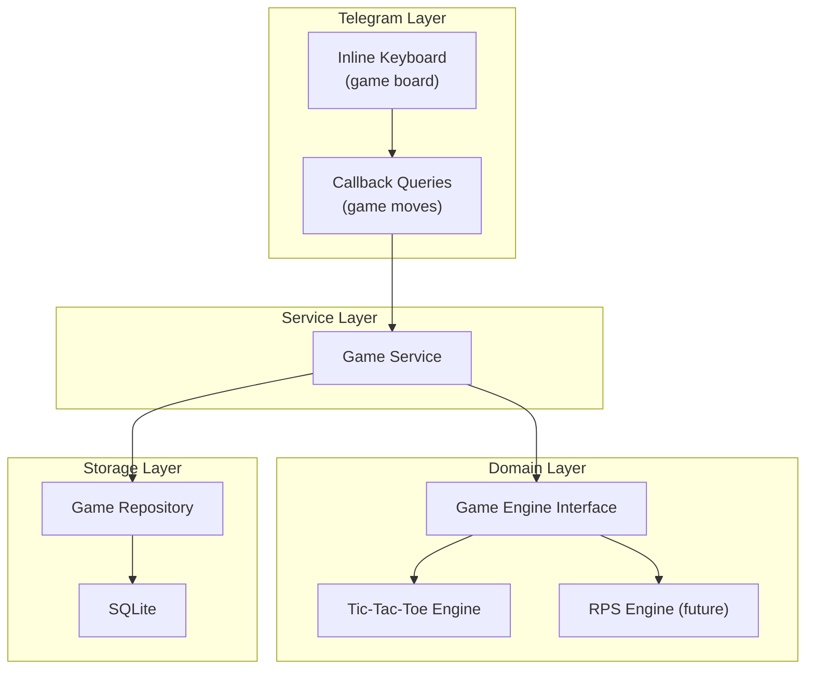
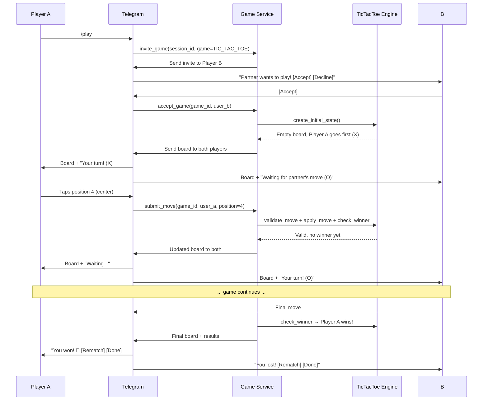

# 16 — Multiplayer Games

## Purpose

Define the game architecture, MVP game selection, server-authoritative state management, and Telegram interaction patterns for multiplayer games.

## Scope

MVP: Tic-tac-toe via inline keyboards. Future games documented for architecture reference.

---

## Game Candidate Evaluation

| Game | Interaction Model | Telegram Feasibility | MVP Candidate | Notes |
|---|---|---|---|---|
| **Tic-tac-toe** | Turn-based, 3×3 grid | ✅ Inline keyboard (3×3) | **YES — MVP** | Simple, well-understood, perfect for keyboard UI |
| Rock-paper-scissors | Simultaneous reveal | ✅ Two inline keyboards | Post-MVP | Needs simultaneous submission + reveal |
| Connect Four | Turn-based, 7×6 grid | ⚠️ Large keyboard (7 cols) | Post-MVP | Keyboard may be cramped on mobile |
| Carrom | Physics-based aiming | ❌ Needs canvas | Future (Mini App) | Requires graphical rendering |
| Air hockey | Real-time physics | ❌ Needs canvas + WebSocket | Future (Mini App) | Real-time latency requirements |
| Stick fight | Real-time arcade | ❌ Needs canvas + WebSocket | Future (Mini App) | Most complex; real-time combat |

### Decision: DECIDED — Tic-tac-toe for MVP

Tic-tac-toe is the only game that works well within Telegram's inline keyboard constraints, is simple to implement correctly, and proves the full game architecture.

---

## Game Architecture

### Principles

1. **Server-authoritative** — All game state lives on the server. Client sends moves; server validates and applies.
2. **Deterministic** — Same input always produces the same output. Enables comprehensive testing.
3. **Extensible** — Abstract `GameEngine` interface allows adding new games without changing the session or communication layer.
4. **Safe** — Never trust client-supplied board state, scores, winners, or turn ownership.

### Component Diagram



### Game Engine Interface

```python
from abc import ABC, abstractmethod

class GameEngine(ABC):
    @abstractmethod
    def create_initial_state(self) -> GameState: ...

    @abstractmethod
    def validate_move(self, state: GameState, player: str, move: dict) -> bool: ...

    @abstractmethod
    def apply_move(self, state: GameState, player: str, move: dict) -> GameState: ...

    @abstractmethod
    def check_winner(self, state: GameState) -> GameResult | None: ...

    @abstractmethod
    def get_legal_moves(self, state: GameState, player: str) -> list[dict]: ...

    @abstractmethod
    def render_board(self, state: GameState) -> str: ...
```

---

## Tic-Tac-Toe Implementation

### Board Representation

```python
# Board positions (0-8):
# 0 | 1 | 2
# ---------
# 3 | 4 | 5
# ---------
# 6 | 7 | 8

# Stored as: ["", "", "", "", "", "", "", "", ""]
# "X" or "O" placed at positions
```

### Win Conditions

```python
WIN_LINES = [
    (0, 1, 2),  # top row
    (3, 4, 5),  # middle row
    (6, 7, 8),  # bottom row
    (0, 3, 6),  # left column
    (1, 4, 7),  # middle column
    (2, 5, 8),  # right column
    (0, 4, 8),  # diagonal
    (2, 4, 6),  # anti-diagonal
]
```

### Move Validation

```python
def validate_move(self, state: GameState, player: str, move: dict) -> bool:
    position = move.get("position")
    if position is None or not (0 <= position <= 8):
        return False  # Invalid position
    if state.board[position] != "":
        return False  # Position already taken
    if state.current_player != player:
        return False  # Not this player's turn
    return True
```

### Inline Keyboard Board

Each cell is a button. Empty cells are clickable (callback = move). Filled cells show X/O and are non-functional.

```
[ X ] [ · ] [ O ]     Callback data for empty cells:
[ · ] [ X ] [ · ]     game:move:{game_id}:{position}
[ O ] [ · ] [ · ]
```

Symbols: `X` = ❌, `O` = ⭕, empty = `·`

### Game Flow



### Timeouts

| Timeout | Duration | Action |
|---|---|---|
| Invitation acceptance | 60 seconds | Game cancelled; inviter notified |
| Turn timeout | 120 seconds | Turn forfeited; opponent wins |
| Game idle timeout | 5 minutes | Game cancelled |

### Rematch

After a game ends, both players are offered `[Rematch] [Done]`:
- **Rematch**: Creates new game with symbols swapped (loser goes first)
- **Done**: Returns to normal chat

---

## Game-Specific Tests

### Tic-Tac-Toe Test Cases

- [ ] Empty board has 9 legal moves
- [ ] Position already taken is rejected
- [ ] Wrong player's turn is rejected
- [ ] All 8 win conditions detected correctly
- [ ] Draw detected when board is full with no winner
- [ ] Game state is consistent after every valid move
- [ ] Cannot submit move after game is over
- [ ] Player cannot submit opponent's move
- [ ] Board rendering matches game state
- [ ] Timeout forfeits correct player
- [ ] Rematch swaps symbols correctly

### Security Tests

- [ ] Forged callback with wrong game_id rejected
- [ ] Forged callback with wrong user_id rejected
- [ ] Move submitted for non-existent game rejected
- [ ] Move submitted for completed game rejected
- [ ] Concurrent moves for same position: only first accepted

---

## Future: Mini App Games

Games requiring graphical rendering (carrom, pool, air hockey, stick fight) will use:

1. **Telegram Mini App** — WebView-based canvas
2. **WebSocket** — Real-time communication for game state synchronization
3. **Server-authoritative** — Same principle; server validates all state
4. **Shared GameEngine interface** — Same domain logic, different rendering

This requires Phase 9 (Multi-Client) and is not implemented in the MVP.

---

## Related Documents

- [Domain Model](07-domain-model.md) — Game entities
- [State Machines](10-state-machines.md) — Game state transitions
- [Data Flow](09-data-flow.md) — Game flow diagrams
- [Telegram Bot Design](11-telegram-bot-design.md) — Keyboard interaction patterns
- [Web & Mini App Future](34-web-and-mini-app-future.md) — Future graphical games
