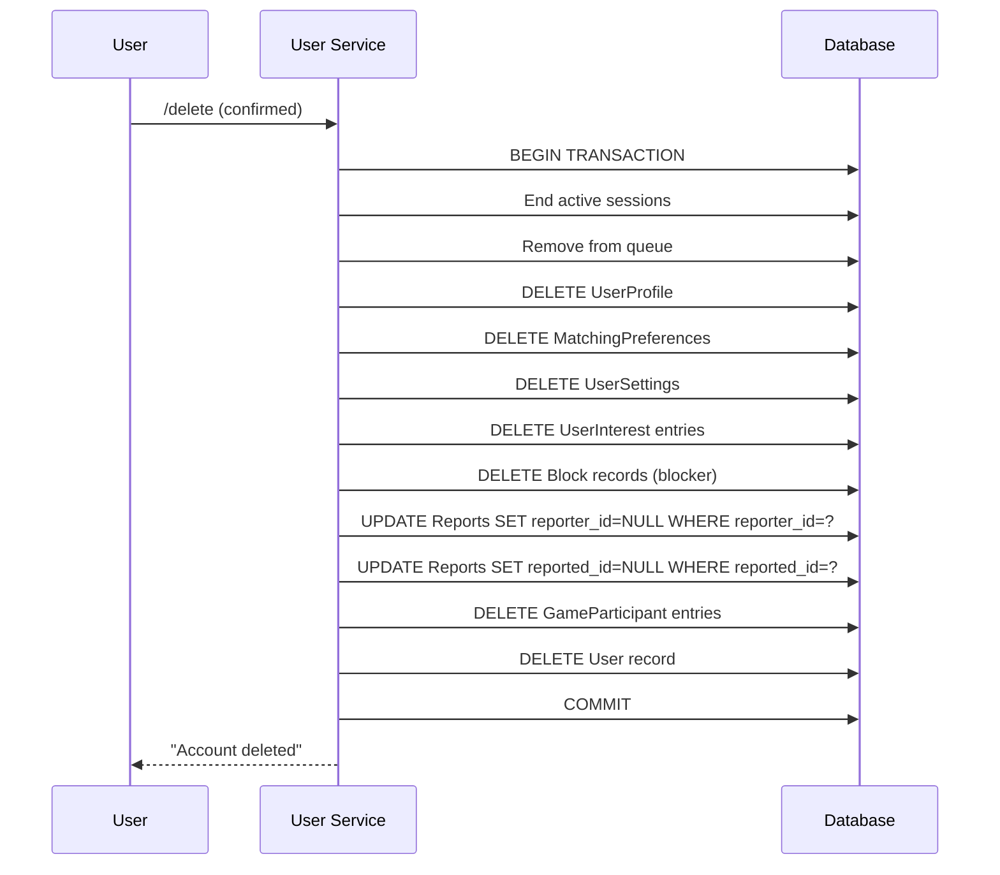

# 19 — Privacy & Data Governance

## Purpose

Define data classification, retention policies, deletion procedures, and privacy controls for all data handled by Tikible.

## Scope

Covers all data categories across the MVP and future phases.

---

## Data Classification Table

| Data Category | Examples | Classification | Retention | Stored? |
|---|---|---|---|---|
| **Identity Mapping** | telegram_id → internal user_id | Private | Until account deletion | Yes (encrypted reference) |
| **Profile** | Display name, bio, gender, age range | User-Controlled | Until user edits/deletes | Yes |
| **Preferences** | Gender preference, age preference | User-Controlled | Until user edits/deletes | Yes |
| **Interests** | Selected interest tags | User-Controlled | Until user edits/deletes | Yes |
| **Settings** | Notification prefs, icebreaker toggle | User-Controlled | Until user edits/deletes | Yes |
| **Message Content** | Chat messages between partners | **Ephemeral** | **NEVER** | **NO** |
| **Session Metadata** | Session ID, start/end time, end reason | Internal | 90 days, then deleted | Yes |
| **Match Score** | Computed compatibility score | Derived | Not stored | No |
| **Block Records** | Who blocked whom | Internal | Until unblock or account deletion | Yes |
| **Reports** | Category, description, status | Sensitive | 90 days, then anonymized | Yes |
| **Moderation Events** | Admin actions, warnings, bans | Sensitive | 1 year | Yes (post-MVP) |
| **Game State** | Board positions, moves, results | Internal | With session (90 days) | Yes |
| **Rate Limit State** | Action counts per window | Ephemeral | In-memory only | No |
| **Audit Events** | System events (login, deletion, admin) | Internal | 90 days | Yes (post-MVP) |
| **Logs** | Structured application logs | Operational | 7 days (Render) | Yes (stdout) |

---

## Retention Schedule

| Data | Retention Period | Deletion Method | Trigger |
|---|---|---|---|
| User account | Until deletion requested | Hard delete + cascade | `/delete` command |
| Profile data | Until deletion or edit | Hard delete with user | Account deletion |
| Message content | **0 seconds** — never stored | N/A | N/A |
| Session metadata | 90 days after session end | Batch delete by date | Scheduled cleanup |
| Reports | 90 days | Anonymize (SET NULL user refs) | Scheduled cleanup |
| Blocks | Until unblock or account deletion | Hard delete | User action |
| Game sessions | With parent session (90 days) | Cascade from session | Session cleanup |
| Logs | 7 days (Render default) | Platform rotation | Automatic |

---

## Privacy Notice Content

The bot's privacy notice (shown during onboarding) must include:

1. **What we collect**: Display name, interests, preferences, blocks, reports (metadata only)
2. **What we DON'T collect**: Message content, phone number, real name, location
3. **Who can see your data**: Only you can see your profile; your partner sees nothing unless you both consent to reveal
4. **Telegram's role**: Telegram processes all messages; we don't control what Telegram stores
5. **Anonymity limits**: We don't share your identity, but we can't prevent screenshots or external recording
6. **Data deletion**: Use `/delete` to permanently remove all your data
7. **Reporting**: Reports include metadata only; report descriptions you provide may be reviewed by moderators

---

## Deletion Procedures

### User-Initiated Account Deletion

### Verification After Deletion

After deletion:
- `get_by_telegram_id(telegram_id)` returns `None`
- No profile, preferences, settings, or interests exist
- Block records where user was blocker are removed
- Reports are preserved but anonymized (no link to deleted user)
- Session participant records are cascade-deleted
- The user can re-register with `/start` (creates new account with new UUID)

---

## Consent Framework

### Current (MVP)

| Action | Consent Mechanism |
|---|---|
| Account creation | Explicit acknowledgment during onboarding |
| Profile data storage | Implicit through profile creation |
| Matching using preferences | Implicit through preference setup |
| Message relay | Implicit through chat participation |
| Report submission | Explicit through report form |

### Future

| Action | Consent Mechanism |
|---|---|
| Mutual identity reveal | Both users must explicitly opt in |
| AI icebreaker generation | Feature toggle in settings |
| AI toxicity scanning | Explicit opt-in with clear explanation |
| Data export | User-initiated action |

---

## Data Flow Privacy Controls

| Data Flow | Privacy Control |
|---|---|
| User → Bot | Telegram transport encryption (TLS) |
| Bot → Partner | No user identity attached; only message text relayed |
| Bot → AI Provider | Interest tags only; NEVER message content |
| Bot → Logs | Redacted structured logs; no content, no telegram_id |
| Bot → Database | Parameterized queries; no message content stored |

---

## GDPR Considerations (REQUIRES RESEARCH)

| Right | Implementation Status |
|---|---|
| Right to access | Post-MVP: `/export` command |
| Right to erasure | MVP: `/delete` command |
| Right to portability | Post-MVP: data export in standard format |
| Right to rectification | MVP: `/profile` edit |
| Right to restrict processing | Post-MVP: account suspension option |
| Right to object | MVP: block and report mechanisms |
| Data minimization | MVP: minimum data collected by design |
| Purpose limitation | MVP: data used only for stated features |

**Open Question:** Formal GDPR compliance requires legal review before EU launch. See [Risk Register](37-risk-register.md).

---

## Related Documents

- [Domain Model](07-domain-model.md) — Entity privacy classifications
- [Entity Relationships](08-entity-relationships.md) — Deletion cascades
- [Security Threat Model](18-security-threat-model.md) — Information disclosure threats
- [Storage & Persistence](20-storage-and-persistence.md) — Physical storage controls
- [Configuration & Secrets](31-configuration-and-secrets.md) — Secret handling
