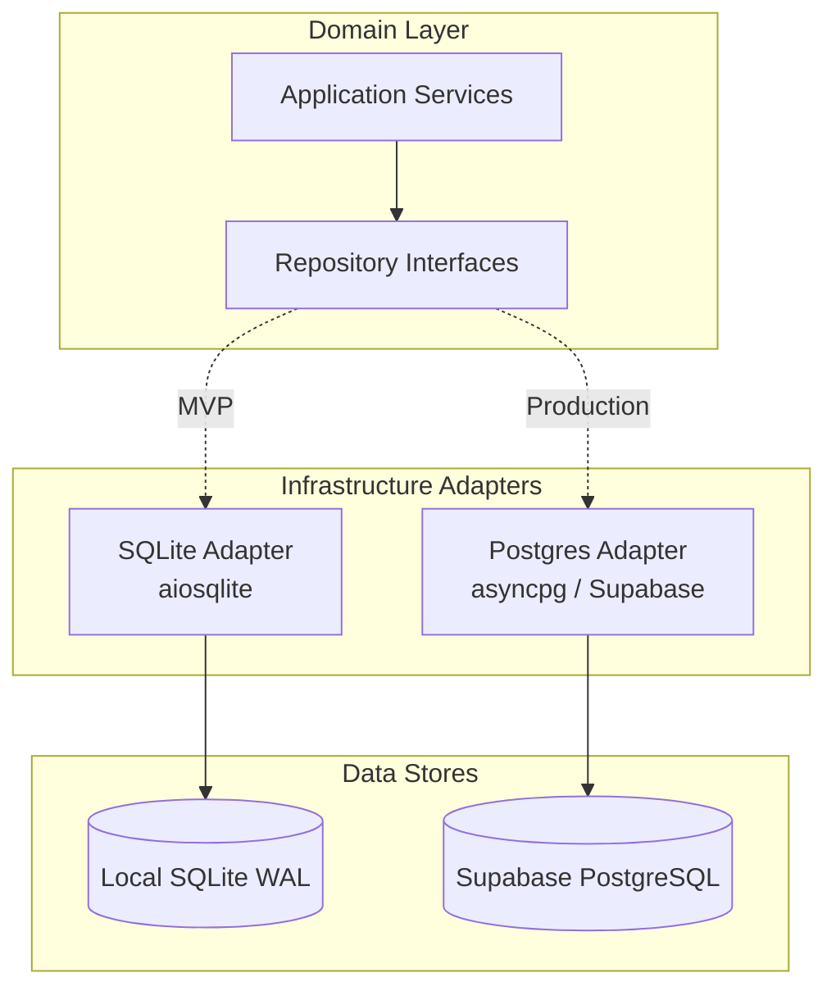

# 21 — Supabase Architecture

## Purpose

Define the target production database architecture using Supabase (managed PostgreSQL). Document schema definition, connection pooling, Row Level Security (RLS) policies, indexing strategies, repository implementation, and real-time considerations.

## Scope

Covers the primary production persistence target for Tikible beyond the local SQLite MVP.

---

## Architectural Context

Supabase provides managed PostgreSQL 15+, automated backups, built-in connection pooling via PgBouncer/Supavisor, Row Level Security (RLS), and optional real-time event broadcasting.

### Alignment with Clean Architecture

Tikible domain logic never references Supabase or PostgreSQL directly. All database access occurs through the repository interfaces defined in [Storage & Persistence](20-storage-and-persistence.md):
- `UserRepository`
- `ProfileRepository`
- `MatchTicketRepository`
- `ChatSessionRepository`
- `GameRepository`
- `ReportRepository`
- `BlockRepository`

The `tikible.repositories.postgres` package implements these interfaces using `asyncpg` and SQLAlchemy Core (or direct SQL queries) configured for Supabase.



---

## Target PostgreSQL Schema

The schema mirrors the relational domain model while leveraging PostgreSQL-specific data types (`TIMESTAMPTZ`, `JSONB`, `UUID`, `INET`, arrays).

```sql
-- Enable necessary extensions
CREATE EXTENSION IF NOT EXISTS "uuid-ossp";
CREATE EXTENSION IF NOT EXISTS "pgcrypto";

-- ============================================================================
-- USERS TABLE
-- ============================================================================
CREATE TABLE users (
    id VARCHAR(36) PRIMARY KEY,
    telegram_id BIGINT UNIQUE NOT NULL,
    state VARCHAR(32) NOT NULL DEFAULT 'ONBOARDING',
    status VARCHAR(32) NOT NULL DEFAULT 'ACTIVE',
    age_verified BOOLEAN NOT NULL DEFAULT FALSE,
    terms_accepted_at TIMESTAMPTZ,
    karma_score INTEGER NOT NULL DEFAULT 100,
    report_count INTEGER NOT NULL DEFAULT 0,
    ban_reason TEXT,
    banned_at TIMESTAMPTZ,
    last_active_at TIMESTAMPTZ NOT NULL DEFAULT NOW(),
    created_at TIMESTAMPTZ NOT NULL DEFAULT NOW(),
    updated_at TIMESTAMPTZ NOT NULL DEFAULT NOW()
);

CREATE INDEX idx_users_telegram_id ON users(telegram_id);
CREATE INDEX idx_users_status_state ON users(status, state);

-- ============================================================================
-- PROFILES TABLE
-- ============================================================================
CREATE TABLE profiles (
    user_id VARCHAR(36) PRIMARY KEY REFERENCES users(id) ON DELETE CASCADE,
    display_name VARCHAR(50) NOT NULL,
    age INTEGER NOT NULL CHECK (age >= 18 AND age <= 120),
    gender VARCHAR(32) NOT NULL,
    bio VARCHAR(500),
    location_country VARCHAR(2), -- ISO 3166-1 alpha-2
    location_city VARCHAR(100),
    languages TEXT[] NOT NULL DEFAULT ARRAY['en']::TEXT[],
    interests JSONB NOT NULL DEFAULT '[]'::JSONB,
    preferred_gender_filter VARCHAR(32)[] NOT NULL DEFAULT ARRAY['ANY']::VARCHAR[],
    min_age_filter INTEGER NOT NULL DEFAULT 18,
    max_age_filter INTEGER NOT NULL DEFAULT 99,
    max_distance_km INTEGER,
    created_at TIMESTAMPTZ NOT NULL DEFAULT NOW(),
    updated_at TIMESTAMPTZ NOT NULL DEFAULT NOW()
);

CREATE INDEX idx_profiles_interests_gin ON profiles USING GIN (interests);
CREATE INDEX idx_profiles_languages ON profiles USING GIN (languages);
CREATE INDEX idx_profiles_age ON profiles(age);

-- ============================================================================
-- MATCH TICKETS TABLE (Active queue)
-- ============================================================================
CREATE TABLE match_tickets (
    id VARCHAR(36) PRIMARY KEY,
    user_id VARCHAR(36) NOT NULL REFERENCES users(id) ON DELETE CASCADE,
    status VARCHAR(32) NOT NULL DEFAULT 'WAITING',
    criteria JSONB NOT NULL DEFAULT '{}'::JSONB,
    created_at TIMESTAMPTZ NOT NULL DEFAULT NOW(),
    expires_at TIMESTAMPTZ NOT NULL,
    matched_at TIMESTAMPTZ,
    matched_user_id VARCHAR(36) REFERENCES users(id) ON DELETE SET NULL,
    session_id VARCHAR(36),
    lock_version INTEGER NOT NULL DEFAULT 1
);

CREATE INDEX idx_match_tickets_queue ON match_tickets(status, created_at)
    WHERE status = 'WAITING';
CREATE UNIQUE INDEX idx_match_tickets_active_user ON match_tickets(user_id)
    WHERE status = 'WAITING';

-- ============================================================================
-- CHAT SESSIONS TABLE
-- ============================================================================
CREATE TABLE chat_sessions (
    id VARCHAR(36) PRIMARY KEY,
    user_a_id VARCHAR(36) NOT NULL REFERENCES users(id) ON DELETE RESTRICT,
    user_b_id VARCHAR(36) NOT NULL REFERENCES users(id) ON DELETE RESTRICT,
    status VARCHAR(32) NOT NULL DEFAULT 'ACTIVE',
    match_score DOUBLE PRECISION NOT NULL DEFAULT 0.0,
    match_metadata JSONB NOT NULL DEFAULT '{}'::JSONB,
    created_at TIMESTAMPTZ NOT NULL DEFAULT NOW(),
    last_activity_at TIMESTAMPTZ NOT NULL DEFAULT NOW(),
    ended_at TIMESTAMPTZ,
    ended_by_user_id VARCHAR(36) REFERENCES users(id) ON DELETE SET NULL,
    termination_reason VARCHAR(64),
    message_count INTEGER NOT NULL DEFAULT 0,
    CONSTRAINT chk_different_users CHECK (user_a_id <> user_b_id)
);

CREATE INDEX idx_chat_sessions_user_a ON chat_sessions(user_a_id, status);
CREATE INDEX idx_chat_sessions_user_b ON chat_sessions(user_b_id, status);
CREATE INDEX idx_chat_sessions_active ON chat_sessions(status) WHERE status = 'ACTIVE';

-- ============================================================================
-- GAMES TABLE
-- ============================================================================
CREATE TABLE games (
    id VARCHAR(36) PRIMARY KEY,
    session_id VARCHAR(36) NOT NULL REFERENCES chat_sessions(id) ON DELETE CASCADE,
    game_type VARCHAR(32) NOT NULL,
    player_x_id VARCHAR(36) NOT NULL REFERENCES users(id) ON DELETE RESTRICT,
    player_o_id VARCHAR(36) NOT NULL REFERENCES users(id) ON DELETE RESTRICT,
    status VARCHAR(32) NOT NULL DEFAULT 'IN_PROGRESS',
    current_turn_user_id VARCHAR(36) NOT NULL REFERENCES users(id) ON DELETE RESTRICT,
    board_state JSONB NOT NULL,
    winner_id VARCHAR(36) REFERENCES users(id) ON DELETE SET NULL,
    move_count INTEGER NOT NULL DEFAULT 0,
    created_at TIMESTAMPTZ NOT NULL DEFAULT NOW(),
    updated_at TIMESTAMPTZ NOT NULL DEFAULT NOW()
);

CREATE INDEX idx_games_session ON games(session_id, status);

-- ============================================================================
-- BLOCKS TABLE
-- ============================================================================
CREATE TABLE user_blocks (
    id VARCHAR(36) PRIMARY KEY,
    blocker_id VARCHAR(36) NOT NULL REFERENCES users(id) ON DELETE CASCADE,
    blocked_id VARCHAR(36) NOT NULL REFERENCES users(id) ON DELETE CASCADE,
    created_at TIMESTAMPTZ NOT NULL DEFAULT NOW(),
    CONSTRAINT uq_blocker_blocked UNIQUE (blocker_id, blocked_id),
    CONSTRAINT chk_block_self CHECK (blocker_id <> blocked_id)
);

CREATE INDEX idx_user_blocks_blocker ON user_blocks(blocker_id);
CREATE INDEX idx_user_blocks_blocked ON user_blocks(blocked_id);

-- ============================================================================
-- REPORTS TABLE
-- ============================================================================
CREATE TABLE reports (
    id VARCHAR(36) PRIMARY KEY,
    reporter_id VARCHAR(36) NOT NULL REFERENCES users(id) ON DELETE RESTRICT,
    reported_id VARCHAR(36) NOT NULL REFERENCES users(id) ON DELETE RESTRICT,
    session_id VARCHAR(36) REFERENCES chat_sessions(id) ON DELETE SET NULL,
    category VARCHAR(64) NOT NULL,
    reason TEXT NOT NULL,
    evidence_snippet TEXT,
    status VARCHAR(32) NOT NULL DEFAULT 'PENDING',
    action_taken VARCHAR(64),
    reviewed_at TIMESTAMPTZ,
    reviewed_by VARCHAR(64),
    created_at TIMESTAMPTZ NOT NULL DEFAULT NOW()
);

CREATE INDEX idx_reports_status ON reports(status, created_at);
CREATE INDEX idx_reports_reported ON reports(reported_id);

-- ============================================================================
-- AUDIT LOGS (Ephemeral / Security)
-- ============================================================================
CREATE TABLE security_audit_logs (
    id BIGSERIAL PRIMARY KEY,
    event_type VARCHAR(64) NOT NULL,
    actor_id VARCHAR(36),
    target_id VARCHAR(36),
    ip_address INET,
    metadata JSONB NOT NULL DEFAULT '{}'::JSONB,
    created_at TIMESTAMPTZ NOT NULL DEFAULT NOW()
);

CREATE INDEX idx_audit_logs_event ON security_audit_logs(event_type, created_at);
```

---

## Connection Pooling & Performance

Supabase provides two ports for PostgreSQL connections:
1. **Direct Connection (Port 5432)**: Standard PostgreSQL connection. Used exclusively for schema migrations (Alembic) and DDL operations.
2. **Transaction Pooler via Supavisor / PgBouncer (Port 6543)**: Session/Transaction pooling mode. Used for all application service queries.

### Asyncpg Configuration

```python
# src/tikible/repositories/postgres/pool.py
from typing import Optional
import asyncpg
from tikible.config import Settings

class PostgresPoolManager:
    """Manages asyncpg connection pool to Supabase."""

    def __init__(self, settings: Settings) -> None:
        self._dsn: str = settings.database_url
        self._min_size: int = settings.db_pool_min_size
        self._max_size: int = settings.db_pool_max_size
        self._pool: Optional[asyncpg.Pool] = None

    async def initialize(self) -> None:
        """Create pool with optimized connection settings for Supabase pooler."""
        self._pool = await asyncpg.create_pool(
            dsn=self._dsn,
            min_size=self._min_size,
            max_size=self._max_size,
            max_inactive_connection_lifetime=300.0,
            command_timeout=15.0,
            statement_cache_size=0, # Required for PgBouncer/Supavisor transaction mode
        )

    async def close(self) -> None:
        if self._pool is not None:
            await self._pool.close()

    @property
    def pool(self) -> asyncpg.Pool:
        if self._pool is None:
            raise RuntimeError("Postgres connection pool is not initialized")
        return self._pool
```

> [!IMPORTANT]
> When connecting to Supabase via transaction pooling (port 6543), prepared statements MUST be disabled (`statement_cache_size=0` in `asyncpg`), as PgBouncer routes consecutive queries across different server processes.

---

## Row Level Security (RLS) Policies

Supabase enforces RLS at the PostgreSQL kernel level. For Tikible's backend service role, queries run with the service key (`postgres` role or `service_role`), which bypasses RLS for high-performance server-side operations.

However, if future web or Mini App clients query Supabase directly via the JavaScript/Dart SDK, RLS guarantees multi-tenant security:

```sql
-- Enable RLS on all tables
ALTER TABLE users ENABLE ROW LEVEL SECURITY;
ALTER TABLE profiles ENABLE ROW LEVEL SECURITY;
ALTER TABLE match_tickets ENABLE ROW LEVEL SECURITY;
ALTER TABLE chat_sessions ENABLE ROW LEVEL SECURITY;
ALTER TABLE games ENABLE ROW LEVEL SECURITY;
ALTER TABLE user_blocks ENABLE ROW LEVEL SECURITY;
ALTER TABLE reports ENABLE ROW LEVEL SECURITY;

-- 1. Profiles: A user can read anyone's profile if active; can only edit their own
CREATE POLICY "Public profiles are readable by authenticated users"
    ON profiles FOR SELECT
    TO authenticated
    USING (true);

CREATE POLICY "Users can only update their own profile"
    ON profiles FOR UPDATE
    TO authenticated
    USING (auth.uid()::text = user_id)
    WITH CHECK (auth.uid()::text = user_id);

-- 2. Chat Sessions: Only participating users can select their sessions
CREATE POLICY "Participants can view their own chat sessions"
    ON chat_sessions FOR SELECT
    TO authenticated
    USING (auth.uid()::text = user_a_id OR auth.uid()::text = user_b_id);

-- 3. Match Tickets: Users can only see and manipulate their own ticket
CREATE POLICY "Users own their match tickets"
    ON match_tickets FOR ALL
    TO authenticated
    USING (auth.uid()::text = user_id)
    WITH CHECK (auth.uid()::text = user_id);

-- 4. User Blocks: Users can only see who they blocked
CREATE POLICY "Users view their own blocklist"
    ON user_blocks FOR SELECT
    TO authenticated
    USING (auth.uid()::text = blocker_id);
```

---

## Real-Time & Webhook Synchronization

Supabase includes Realtime (Phoenix Channels over WebSockets). 

### Use Case Evaluation
- **Bot Message Relay**: NOT routed through Supabase Realtime. Messages are relayed in-memory via Redis Pub/Sub or direct bot API calls to prevent persistent chat storage.
- **Queue Notification**: Optional. When a match ticket is accepted, a Supabase Realtime broadcast can notify a worker node to dispatch the Telegram notification.
- **Admin Dashboard**: Supabase Realtime broadcasts moderation reports directly to the admin interface.

---

## Migration Strategy (Alembic)

Database schema versioning is managed with **Alembic**:

```ini
# alembic.ini excerpt
[alembic]
script_location = migrations
sqlalchemy.url = %(DATABASE_DIRECT_URL)s
```

Migrations are executed during continuous deployment before the application workers spin up. Rollbacks are validated automatically in CI against a test database container.
