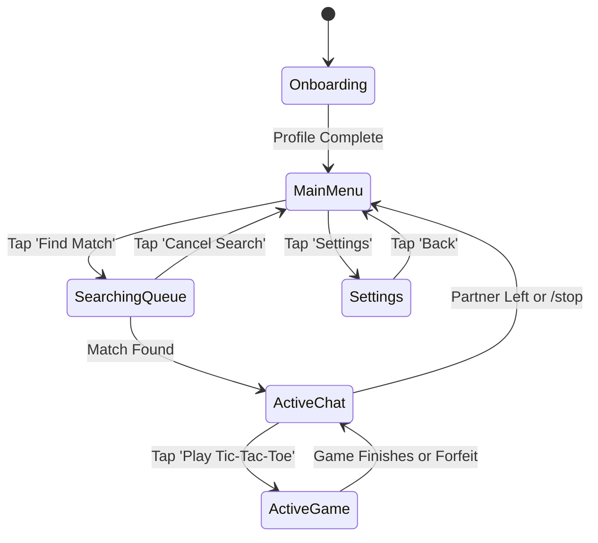

# 24 — UI/UX & Conversation Design

## Purpose

Define the conversational experience, persona, message copy guidelines, keyboard layouts, and interaction patterns for LikBy across Telegram bot interactions and future Mini App interfaces.

## Scope

Covers the voice and tone, exact copy templates, visual formatting, inline/reply keyboard hierarchies, and progressive disclosure patterns.

---

## Brand Persona & Voice

LikBy's voice is:
- **Calm & Respectful**: Welcoming and non-judgmental. Avoids hyper-energetic marketing hype or corporate sterility.
- **Privacy-First & Transparent**: Explains *why* certain inputs are asked (e.g., age verification) and affirms data ephemeral nature.
- **Concise & Direct**: Mobile screen space in Telegram is limited. Messages should be skimmable in under 3 seconds.
- **Safety-Centric**: Clear pathways to report, block, or exit any interaction instantly.

| Dimension | LikBy Approach | Anti-Pattern to Avoid |
|---|---|---|
| **Tone** | Friendly, polite, discreet | Boisterous, teasing, patronizing |
| **Length** | 1 to 3 short paragraphs max | Massive blocks of wall-of-text |
| **Formality** | Conversational, approachable | Overly formal legalese or edgy slang |
| **Emoji Use** | Functional anchors (1-2 per message) | Emoji soup filling entire lines |

---

## Message Formatting Conventions

LikBy standardizes on Telegram **HTML parsing mode** rather than MarkdownV2 to eliminate brittle regex escaping bugs with punctuation marks (`.`, `!`, `-`, `(`).

### Formatting Rules
- **Bold (`<b>`)**: Used sparingly for key headings, status words, and calls to action.
- **Italic (`<i>`)**: Used for system status reflections, quotes, or conversational cues.
- **Code (`<code>`)**: Used for IDs, referral codes, or command syntax (e.g., `<code>/stop</code>`).
- **Hyperlinks (`<a href="...">`)**: Used only for Terms of Service, Privacy Policy, and support links. Never link to unverified external trackers.

---

## Keyboard Hierarchy & Interaction States



### 1. Main Menu Keyboard (Persistent Reply Keyboard)

Layout is designed for one-thumb ergonomics:

```
+------------------------------------------+
|            🎲 Find a Match               |
+--------------------+---------------------+
|   👤 My Profile    |   ⚙️ Preferences    |
+--------------------+---------------------+
|   📜 Guidelines    |   ❓ Help / About   |
+--------------------+---------------------+
```

### 2. Match Queue Interface

When entering the queue, send a single status message with an **Inline Keyboard** allowing instant cancellation:

```html
<b>🔍 Looking for a conversation partner...</b>

<i>Criteria: Similar interests, active within your preferred age bracket.</i>
⏱ <i>Estimated wait: ~30 seconds</i>
```

Inline Keyboard:
```
[ ❌ Cancel Search ]
```

### 3. Active Chat Interface & Controls

Once matched, an icebreaker header is posted to both users:

```html
🎉 <b>Connected to an anonymous partner!</b>

🤝 <b>Common ground:</b> Gaming, Technology
💬 <i>Be respectful, stay anonymous, and have fun.</i>

Commands available:
• <code>/game</code> — Challenge partner to Tic-Tac-Toe
• <code>/next</code> — Skip to another person
• <code>/stop</code> — End conversation
• <code>/report</code> — Flag inappropriate behavior
```

Active Chat Reply Keyboard:
```
+--------------------+---------------------+
|    🎮 Play Game    |     ⏭ Next Chat     |
+--------------------+---------------------+
|    🚫 End Chat     |     ⚠️ Report       |
+--------------------+---------------------+
```

---

## Complete Message Copy Catalog

### Onboarding Flow

#### Step 1: Welcome & Age Gate
```html
👋 <b>Welcome to LikBy.</b>

LikBy connects you with thoughtful people for <b>100% anonymous, real-time conversations</b>.

🔒 <b>Our core promise:</b>
• We never reveal your Telegram username or phone number.
• Chat messages are never stored permanently in our database.
• You can leave or block at any second.

⚠️ <i>To ensure a safe environment, you must be 18 years or older.</i>
```
*Inline Keyboard:*
`[ ✅ I am 18 or older ]` `[ ❌ I am under 18 ]`

#### Step 2: Display Name Entry
```html
🏷 <b>Choose your display alias</b>

Pick a nickname for your profile (2-20 characters). This can be a pseudonym—it does <b>not</b> have to be your real name.
```

#### Step 3: Age & Gender Selection
```html
🎂 <b>How old are you?</b>

<i>Please type your age as a number (e.g. 24). This is only used to match you within appropriate age preferences.</i>
```

```html
⚧ <b>Select your gender identity</b>
```
*Inline Keyboard:*
`[ 👨 Male ]` `[ 👩 Female ]`
`[ 🧑 Non-Binary ]` `[ ⚪ Prefer Not to Say ]`

#### Step 4: Interests Selection
```html
🎯 <b>Select 3 to 5 interests you enjoy discussing:</b>

<i>Tap to toggle on/off, then press Done.</i>
```
*Inline Keyboard (Matrix):*
`[ ☕ Coffee ]` `[ 📚 Books ]` `[ 🎮 Gaming ]`
`[ 💻 Tech ]` `[ 🎵 Music ]` `[ ✈️ Travel ]`
`[ 🎨 Art ]` `[ 🍿 Movies ]` `[ 🏋️ Fitness ]`
`[ ✅ Done (3 Selected) ]`

---

### In-Chat & Termination Copy

#### Partner Disconnected / Ended Chat
```html
🛑 <b>Your partner has ended the chat session.</b>

<i>Your messages are no longer being forwarded. Would you like to find someone new?</i>
```
*Inline Keyboard:*
`[ 🎲 Find New Match ]` `[ 🏠 Main Menu ]`

#### Inactivity Warning (After 4 minutes of silence)
```html
⏰ <b>Are you still there?</b>

<i>This session will automatically close in 60 seconds due to inactivity. Send a message to keep chatting!</i>
```

#### Abuse Report Modal
```html
⚠️ <b>Report User</b>

Please select the reason for reporting this user:
```
*Inline Keyboard:*
`[ 🔞 NSFW / Explicit Content ]`
`[ 🦹 Harassment / Hate Speech ]`
`[ 🤖 Spam / Commercial Promotion ]`
`[ ❌ Cancel ]`

---

## Accessibility & Localization Strategy

1. **Screen Reader Optimization**: Emoji icons are consistently accompanied by textual descriptors (e.g., `[ ❌ Cancel ]` rather than just `[ ❌ ]`).
2. **Color Blindness**: Tic-tac-toe games use distinct glyphs (`❌` and `⭕`) rather than relying on colored circles.
3. **i18n Architecture**: All user-facing strings are stored in `src/likby/telegram/locales/{lang}.json` with key-based lookup (`get_text("onboarding.welcome", lang="es")`).
