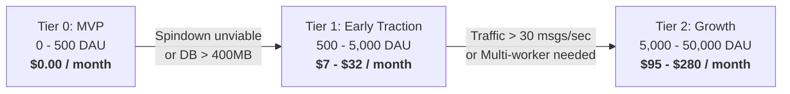
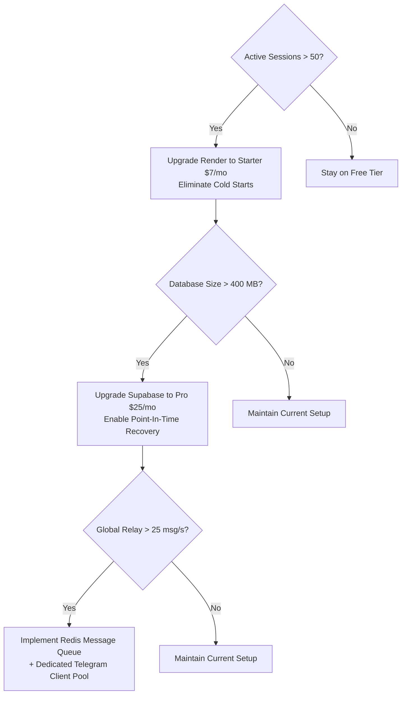

# 29 — Free-Tier & Cost Model

## Purpose

Document the comprehensive infrastructure cost analysis, service quota limits across free tiers, unit economics per active user, and milestone-based upgrade triggers.

## Scope

Covers Render, Supabase, Telegram Bot API, Cloudflare, AI providers, and monitoring tools.

---

## Free-Tier Quotas & Operational Limits

| Component | Provider | Free Tier Limits | Hard Ceilings & Behaviors |
|---|---|---|---|
| **Web Service Runtime** | Render | 750 free hours/month, 512 MB RAM, 0.1 CPU | Spins down after 15m idle; container file system is ephemeral. |
| **Relational Database** | Supabase | 500 MB storage, 2 active projects, 50,000 monthly active users (MAU) | Database paused after 7 days without queries. Max 60 pooled connections. |
| **Messaging Gateway** | Telegram Bot API | Free | 30 messages/second globally; 1 message/second per user chat. |
| **Edge DNS & SSL** | Cloudflare | Free Plan | Unlimited DNS, free SSL termination, DDoS protection. |
| **Uptime Monitoring** | BetterStack / UptimeRobot | 50 monitors, 3-minute check interval | Free alerts via email and Telegram webhook. |
| **AI LLM Gateway** | Groq / Google Gemini Free | Groq: 30 requests/min, 14,400 req/day; Gemini: 15 req/min | Returns HTTP 429 when quota exceeded. |

---

## Cost Projections by Scale Tier

### Tier 0: Prototype / MVP (0 - 500 Daily Active Users)
- **Render Web Service**: Free ($0)
- **Supabase PostgreSQL**: Free Tier ($0)
- **Cloudflare DNS**: Free ($0)
- **Uptime Ping**: Free ($0)
- **Total Monthly Cost**: **$0.00**

### Tier 1: Early Traction (500 - 5,000 DAU)
*Trigger: Cold starts unacceptable; persistent connection pooling needed.*
- **Render Starter Web Service** (no spin-down, 512 MB RAM, persistent CPU): **$7.00/mo**
- **Supabase Micro Plan** (or Pro at $25/mo for no pausing, daily backups): **$10.00 - $25.00/mo**
- **AI Icebreaker Quota** (Groq paid or Gemini pay-as-you-go): **$5.00/mo**
- **Total Monthly Cost**: **$22.00 - $37.00/month**

### Tier 2: Growth & Scale (5,000 - 50,000 DAU)
*Trigger: Multiple ASGI workers, dedicated Redis cache for Pub/Sub, Telegram rate limiting.*
- **Render Standard Web Service** (2 GB RAM, 1 CPU, 2 instances): **$50.00/mo**
- **Managed Redis (Upstash / Redis Cloud)**: **$10.00/mo**
- **Supabase Pro Database** (8 GB storage, PITR backups, compute add-on): **$50.00/mo**
- **Logflare / BetterStack Pro Logging**: **$15.00/mo**
- **Total Monthly Cost**: **$125.00/month**

---

## Unit Economics (Per Active User)

Based on Tier 1 traction metrics:
- Average session length: 8 minutes
- Average messages exchanged per session: 24 messages
- Storage footprint per user profile: ~1.2 KB
- Storage footprint per session record (metadata only): ~0.8 KB
- **Cost per Monthly Active User (MAU)**: **~$0.004 to $0.007 / user / month**

Because LikBy does NOT store message payloads, storage costs scale with user registrations and match counts rather than conversational volume.

---

## Upgrade Inflection Triggers

Operational signals that dictate immediate plan upgrades:

---

## Cost Optimization & Guardrails

1. **Zero Chat Storage**: By strictly discarding chat messages after memory relay, database storage needs are reduced by over 98% compared to traditional messaging apps.
2. **AI Throttling**: Icebreaker generation is restricted to 1 prompt per newly established chat session, with results cached by interest combination (e.g., all "Gaming + Tech" matches share pre-generated icebreakers from an in-memory pool).
3. **Bandwidth Minimization**: Inline game updates use Telegram's `editMessageReplyMarkup` instead of posting new messages, saving 90% of outbound Telegram bandwidth and avoiding rate limits.
