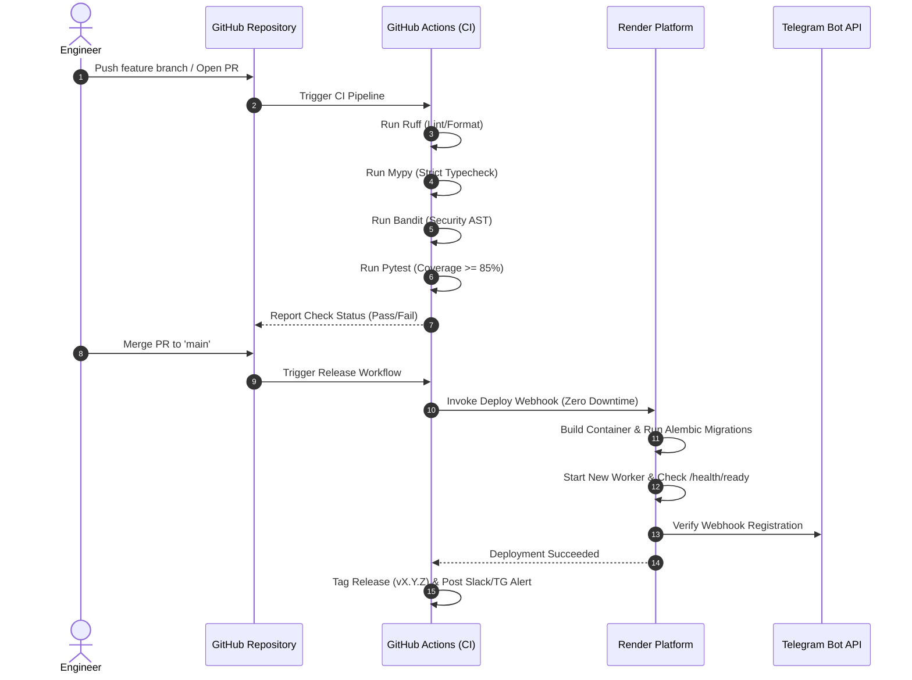

# 30 — CI/CD & Release Process

## Purpose

Define the continuous integration, continuous delivery, automated quality gates, branch management strategy, and release procedures for LikBy.

## Scope

Covers GitHub Actions workflow definitions, static analysis, test automation, semantic versioning, deployment automation to Render, and post-deployment validation.

---

## Release Pipeline Overview



---

## GitHub Actions Workflows

### 1. Continuous Integration Workflow (`.github/workflows/ci.yml`)

Runs on every Pull Request and push to `main`:

```yaml
name: Continuous Integration

on:
  push:
    branches: [main]
  pull_request:
    branches: [main]

jobs:
  validate:
    name: Code Quality & Test Suite
    runs-on: ubuntu-latest
    strategy:
      matrix:
        python-version: ["3.11", "3.12"]

    steps:
      - name: Check out repository
        uses: actions/checkout@v4

      - name: Set up Python ${{ matrix.python-version }}
        uses: actions/setup-python@v5
        with:
          python-version: ${{ matrix.python-version }}
          cache: "pip"

      - name: Install dependencies
        run: |
          python -m pip install --upgrade pip
          pip install -e '.[dev,test]'

      - name: Lint and formatting check (Ruff)
        run: |
          ruff check src tests
          ruff format --check src tests

      - name: Type checking (Mypy)
        run: |
          mypy src tests

      - name: Security scan (Bandit)
        run: |
          bandit -r src -c pyproject.toml

      - name: Run test suite with coverage gate
        run: |
          pytest --cov=src/likby --cov-report=xml --cov-fail-under=85

      - name: Upload coverage report
        uses: codecov/codecov-action@v4
        with:
          file: ./coverage.xml
          fail_ci_if_error: false
        env:
          CODECOV_TOKEN: ${{ secrets.CODECOV_TOKEN }}
```

### 2. Continuous Deployment Workflow (`.github/workflows/deploy.yml`)

Runs automatically upon merge to `main` after CI succeeds:

```yaml
name: Continuous Deployment

on:
  push:
    branches: [main]

jobs:
  deploy:
    name: Trigger Render Deployment
    runs-on: ubuntu-latest
    needs: [validate]
    if: github.ref == 'refs/heads/main'

    steps:
      - name: Check out repository
        uses: actions/checkout@v4

      - name: Invoke Render Deploy Hook
        run: |
          curl -s -X POST "${{ secrets.RENDER_DEPLOY_HOOK_URL }}"
        
      - name: Wait for Deployment & Smoke Test
        run: |
          echo "Waiting 45s for container initialization..."
          sleep 45
          curl -f -s https://api.likby.com/health/ready || (echo "Health check failed!" && exit 1)
```

---

## Branching & Release Strategy

### Trunk-Based Development
- **`main`**: Always deployable, protected branch. Direct pushes prohibited; requires PR approval + passing CI.
- **Short-Lived Feature Branches**: `feat/description`, `fix/ticket-id`, `docs/update`. Merged via Squash and Merge.

### Semantic Versioning (SemVer 2.0.0)
- **MAJOR (`X.0.0`)**: Incompatible API changes, breaking storage migrations without backward compatibility.
- **MINOR (`0.Y.0`)**: Backward-compatible new features (e.g., new multiplayer game, Mini App support).
- **PATCH (`0.0.Z`)**: Backward-compatible bug fixes and performance improvements.

---

## Rollback Procedures

### Application Rollback
If a deployment introduces a critical regression in production:
1. Open Render Dashboard -> **Deploys**.
2. Select previous known healthy deploy commit and click **Rollback**.
3. Render immediately routes incoming traffic to the previous container image.

### Database Migration Rollback
If a schema migration failed mid-way or caused query latency:
```bash
# Execute within deployment container or secure bastion
alembic downgrade -1
```
> [!WARNING]
> Database down-migrations must never drop non-empty columns without prior data archival. All schema changes follow the **Expand and Contract pattern**.
