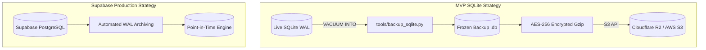

# 32 — Backup & Recovery

## Purpose

Define the data protection strategy, backup automation pipelines, Recovery Point Objectives (RPO), Recovery Time Objectives (RTO), and disaster recovery restoration procedures for Tikible.

## Scope

Covers both the MVP SQLite persistence tier and the target Supabase PostgreSQL production tier.

---

## Recovery Objectives

| Metric | Definition | MVP (SQLite Tier) | Production (Supabase PG Tier) |
|---|---|---|---|
| **RPO (Recovery Point Objective)** | Maximum acceptable data loss duration | **≤ 6 hours** | **≤ 5 minutes** (Point-In-Time Recovery) |
| **RTO (Recovery Time Objective)** | Maximum acceptable downtime to restore | **≤ 30 minutes** | **≤ 15 minutes** |

> [!NOTE]
> Because Tikible stores **zero chat messages**, disaster recovery restores user profiles, blocklists, and moderation history. Active chat sessions and matchmaking tickets are ephemeral and are naturally recreated by users reconnecting.

---

## Backup Architecture



---

## SQLite Automated Backup Pipeline (`tools/backup_sqlite.py`)

This automated script creates an online transaction-safe snapshot and uploads it to S3/Cloudflare R2:

```python
#!/usr/bin/env python3
"""
tools/backup_sqlite.py
Performs a zero-lock online snapshot of the SQLite database and syncs to object storage.
"""
import os
import sqlite3
import gzip
import shutil
from datetime import datetime
import boto3

DB_PATH = os.getenv("SQLITE_PATH", "/data/tikible.db")
BACKUP_DIR = "/backup/snapshots"
S3_BUCKET = os.getenv("BACKUP_S3_BUCKET", "tikible-backups")

def perform_backup():
    os.makedirs(BACKUP_DIR, exist_ok=True)
    timestamp = datetime.utcnow().strftime("%Y%m%d_%H%M%S")
    raw_snapshot = os.path.join(BACKUP_DIR, f"tikible_{timestamp}.db")
    compressed_file = f"{raw_snapshot}.gz"

    print(f"[*] Starting online SQLite snapshot: {DB_PATH} -> {raw_snapshot}")
    conn = sqlite3.connect(DB_PATH)
    try:
        # VACUUM INTO safely creates an atomic copy without blocking active readers/writers
        conn.execute(f"VACUUM INTO '{raw_snapshot}';")
    finally:
        conn.close()

    print("[*] Compressing snapshot...")
    with open(raw_snapshot, 'rb') as f_in, gzip.open(compressed_file, 'wb') as f_out:
        shutil.copyfileobj(f_in, f_out)
    os.remove(raw_snapshot) # Clean up raw file

    # Upload to Cloudflare R2 / S3
    if os.getenv("AWS_ACCESS_KEY_ID"):
        print(f"[*] Uploading to object storage bucket: {S3_BUCKET}...")
        s3 = boto3.client("s3")
        s3.upload_file(compressed_file, S3_BUCKET, f"sqlite/{os.path.basename(compressed_file)}")
        print("[+] Upload complete.")

if __name__ == "__main__":
    perform_backup()
```

---

## Retention Policy Schedule

| Tier | Frequency | Retention Window | Storage Class |
|---|---|---|---|
| **Hourly Snapshots** | Every 6 hours | 48 hours | Standard Object Storage |
| **Daily Snapshots** | Daily at 02:00 UTC | 30 days | Standard / Infrequent Access |
| **Monthly Snapshots** | 1st of every month | 365 days | Glacier / Deep Archive |

---

## Step-by-Step Restoration Runbook

### SQLite Restoration Procedure
In the event of filesystem corruption or accidental deletion:

1. **Stop Application Service**:
   ```bash
   # Scale worker to 0 in Render dashboard or stop local process
   ```
2. **Download Target Backup Snapshot**:
   ```bash
   aws s3 cp s3://tikible-backups/sqlite/tikible_20261015_120000.db.gz /tmp/backup.db.gz
   gunzip /tmp/backup.db.gz
   ```
3. **Verify Integrity of Recovered File**:
   ```bash
   sqlite3 /tmp/backup.db "PRAGMA integrity_check;"
   # Output MUST return 'ok'
   ```
4. **Replace Production Database File**:
   ```bash
   mv /tmp/backup.db /data/tikible.db
   chmod 600 /data/tikible.db
   ```
5. **Restart Service & Verify Health**:
   ```bash
   curl -f http://localhost:8000/health/ready
   ```

### PostgreSQL (Supabase) Restoration Procedure
1. Navigate to Supabase Dashboard -> **Database** -> **Backups**.
2. Select target point-in-time or snapshot.
3. Click **Restore to New Project** or **In-Place Restore**.
4. If restored to a new project, update `DATABASE_URL` in Render and redeploy.
