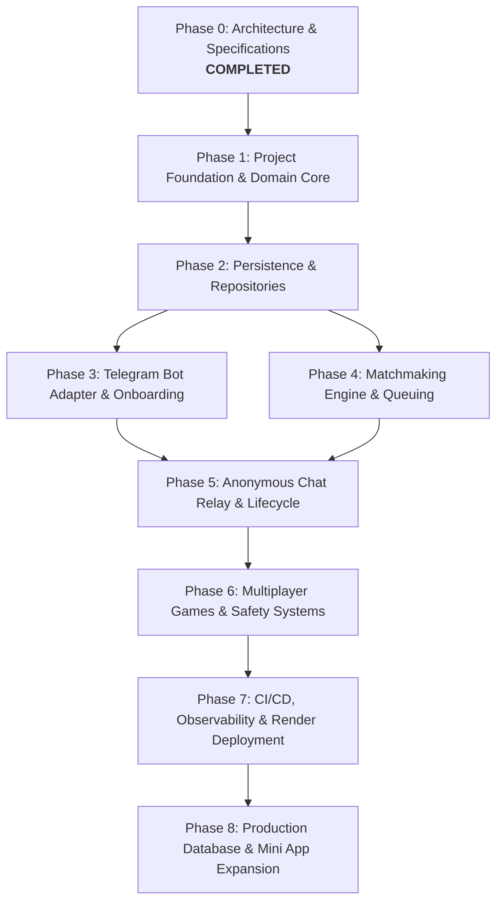

# 35 — Implementation Roadmap

## Purpose

Define the dependency-ordered engineering work breakdown structure (WBS), implementation phases, milestones, and deliverable validation gates for building Tikible.

## Scope

Covers implementation from initial codebase scaffolding through MVP launch, testing, and production deployment.

---

## Phase Dependency Graph

---

## Work Breakdown Structure (WBS)

### Phase 1: Foundation & Domain Layer
- [ ] Initialize Python 3.11 project with `pyproject.toml`, `ruff`, and `mypy` strict configurations.
- [ ] Define core domain value objects and entities: `User`, `Profile`, `MatchTicket`, `ChatSession`, `GameSession`, `Report`, `Block`.
- [ ] Implement deterministic domain rules: age eligibility checks, interest similarity scorer, state machine transitions.
- [ ] Implement pure unit tests achieving ≥ 95% coverage for domain packages.

### Phase 2: Storage Abstraction & SQLite Adapter
- [ ] Define generic repository interfaces in `tikible.domain.repositories`.
- [ ] Implement SQLite adapter using `aiosqlite` with WAL mode and foreign key pragmas.
- [ ] Implement atomic migration system and schema initialization scripts.
- [ ] Write integration test suite verifying transactions, constraints, and busy timeout behavior.

### Phase 3: Telegram Adapter & User Onboarding
- [ ] Configure `aiogram 3.x` Dispatcher, Routers, and webhook/polling runtime modes.
- [ ] Implement `pydantic-settings` typed configuration and environment validation.
- [ ] Build conversation FSM for onboarding: age gate, alias, gender, and multi-select interest matrix.
- [ ] Build persistent Reply Keyboard (Main Menu: Find Match, Profile, Settings, Help).

### Phase 4: Matchmaking Engine
- [ ] Implement in-memory and database-backed `MatchTicket` priority queue.
- [ ] Implement compatibility scoring algorithm with reciprocal preference validation.
- [ ] Build concurrent queue worker loop with configurable tick rate (1-2 seconds).
- [ ] Build search cancellation, timeout expiration (5 minutes), and fairness rotation.

### Phase 5: Anonymous Chat Relay & Inactivity Monitoring
- [ ] Implement `ActiveSessionCache` for sub-millisecond session lookup by Telegram ID.
- [ ] Implement zero-persistence message forwarding logic (text only in MVP).
- [ ] Implement `/stop` (graceful termination) and `/next` (skip and re-queue) command handlers.
- [ ] Implement background session inactivity reaper (4-minute warning, 5-minute close).
- [ ] Privacy regression test: verify zero message bodies persist in database tables.

### Phase 6: Multiplayer Games & Safety Controls
- [ ] Implement server-authoritative Tic-Tac-Toe state machine and win-condition evaluator.
- [ ] Build 3x3 inline keyboard renderer and handle callback queries.
- [ ] Implement `/report` modal flow with categorized reasons and auto-suspend triggers.
- [ ] Implement `/block` reciprocal barrier ensuring blocked pairs never match.
- [ ] Implement sliding-window rate limiters for updates and relay messages.

### Phase 7: Deployment, Observability & CI/CD
- [ ] Configure `render.yaml` for zero-downtime web service deployment.
- [ ] Implement `/health/live` and `/health/ready` endpoints with dependency checks.
- [ ] Configure JSON structured logging with automatic privacy sanitization.
- [ ] Write GitHub Actions workflows for linting, strict typing, tests, and automated deployment.

---

## Milestone Schedule & Delivery Gates

| Milestone | Key Deliverable | Gate Criteria |
|---|---|---|
| **M1: Core Engine** | Domain models + SQLite repositories | All unit & repository tests pass with > 90% coverage |
| **M2: Bot Interactive** | Onboarding + Profile editing in Telegram | Bot completes registration in Telegram test environment |
| **M3: Matching & Chat** | Matchmaking + Two-way anonymous relay | 2 simultaneous users matched; messages relayed seamlessly |
| **M4: Feature Complete** | Tic-Tac-Toe + Reporting + Blocklist | All acceptance criteria satisfied; privacy tests verified |
| **M5: Production Launch** | Render deploy + Health checks live | Production webhook active with zero errors on `/health/ready` |
