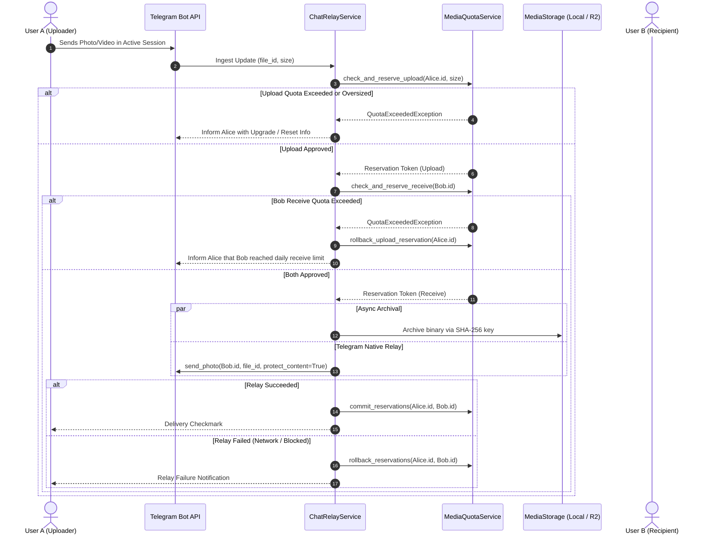
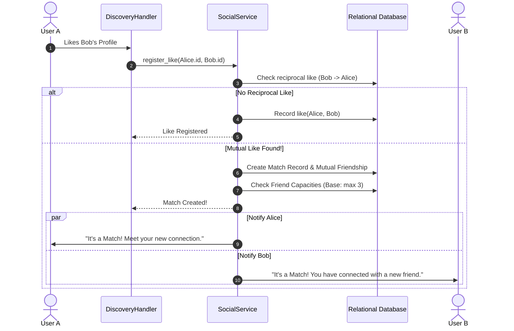

# LikBy Data Flow & Sequence Diagrams

---

## 1. Media Upload & Protected Relay Flow

This diagram illustrates how an uploaded photo/video is verified against quotas, archived, and relayed to a chat partner with content protection.

---

## 2. Matchmaking & Mutual Like Flow

