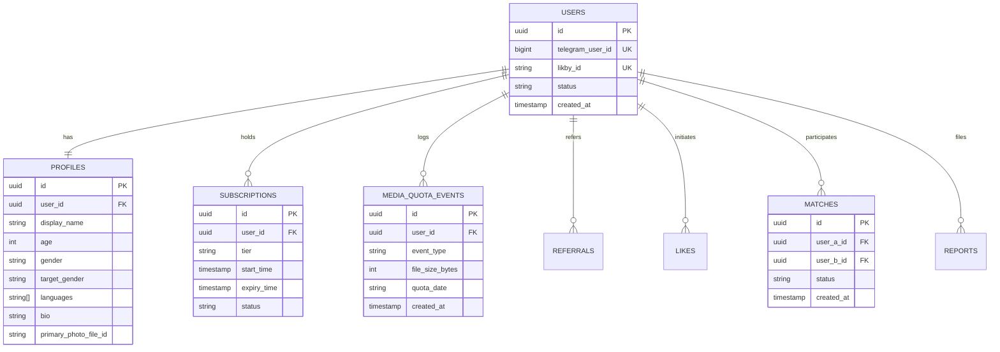

# LikBy Entity Relationship Model

---

## 1. Entity-Relationship Diagram (Relational Core)

---

## 2. Integrity & Constraint Guarantees

1. **Unique Public Identifier:** `likby_id` has a unique index across `users`. Case-insensitive alphanumeric format `[a-z0-9_]{3,24}`.
2. **Deterministic Match Uniqueness:** To prevent duplicate match records under concurrent mutual likes, `user_a_id` is guaranteed to be lexicographically smaller than `user_b_id` (`user_a_id < user_b_id`) with a compound unique constraint on `(user_a_id, user_b_id)`.
3. **Daily Quota Ledger Integrity:** `MEDIA_QUOTA_EVENTS` records atomic reservations with idempotent transaction IDs to prevent double-charging or phantom quota leaks.
