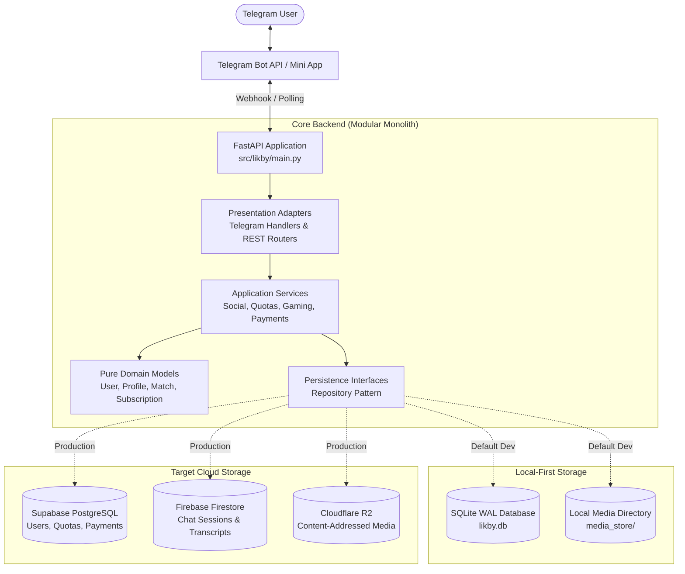

# LikBy System Architecture

**Product:** LikBy (*Meet. Connect. Play.*)  
**Architecture Pattern:** Clean Architecture / Hexagonal Modular Monolith  
**Primary Interface:** Telegram Bot API (via `aiogram 3.x`) & Telegram Mini Apps (`HTML5/Canvas`)  
**Shared Backend:** FastAPI (Python 3.11+)  
**Target Environments:** Local-First (SQLite + Local Disk) & Cloud (Render + Supabase + Firestore + Cloudflare R2)

---

## 1. Architectural Philosophy & Overview

LikBy is designed as a **modular monolith** that balances rapid development, local testability without cloud dependencies, and cost-effective scaling to tens of thousands of daily active users.

---

## 2. Core Architectural Invariants

1. **Shared Domain Core:** Telegram handlers, Mini Apps, and future web endpoints invoke the exact same application services (`src/likby/services/`). No client possesses private business logic.
2. **Local-First Independence:** The system boots and passes 100% of unit and integration tests using SQLite WAL mode without contacting Supabase, Firestore, or Cloudflare R2.
3. **Explicit Cloud Enforcement:** In `APP_ENV=production`, missing cloud credentials cause a fast-fail exit at boot. The system never silently falls back to ephemeral local storage in production.
4. **Non-Negotiable Persistence:** No self-destructing messages, view-once media, or ephemeral countdown timers. User chat histories and shared media persist until deliberate user deletion.
5. **Strict Content Protection:** All outbound media messages in Telegram use `protect_content=True` to prevent in-app forwarding and saving on supported clients.
6. **Zero-Advertising Guarantee:** Zero ad networks, zero tracking SDKs, zero sponsored chat injections.
