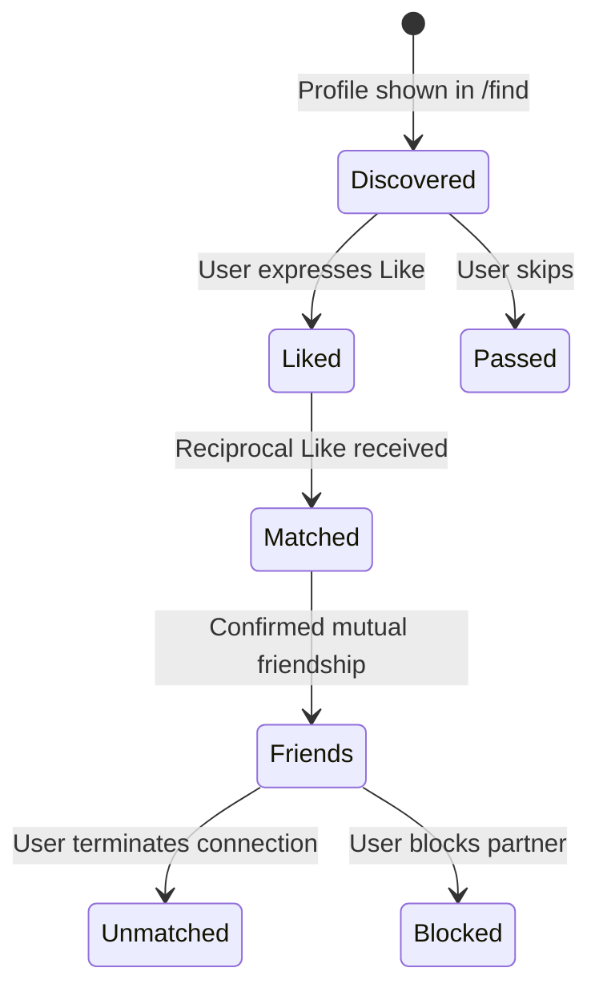

# LikBy Matching & Friendship Architecture

---

## 1. The Social State Machine

---

## 2. Invariants & Rules

1. **Uniqueness:** A match between User A and User B is unique and canonical (`user_a_id < user_b_id`).
2. **Friend Capacity:** Base tier allows up to 3 active friends. If User A has 3 friends, a new mutual match cannot transition to active friendship until an existing friend is removed or User A upgrades.
3. **Immediate Severing on Block:** Blocking severes chat sessions, prevents future discovery, and removes friendship status instantly.
