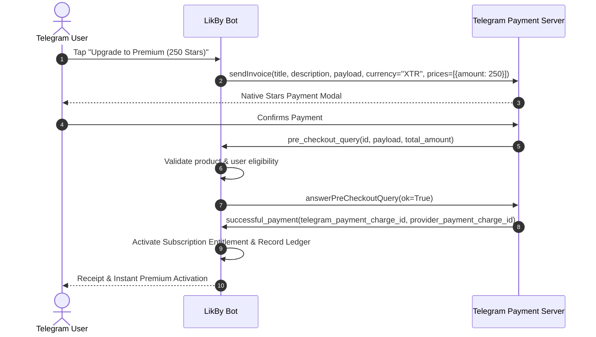

# LikBy Telegram Stars Integration & Lifecycle

---

## 1. Lifecycle Events

---

## 2. Customer Support & Reconciliation
- The command `/paysupport` provides users with recent transaction IDs and an immediate link to customer support.
